# English homepage preview, 2026-11-03

The [2026-11-03 demonstration images have been checked](https://github.com/BTTSpace/KiKAiTO-client-communication/pull/28#issuecomment-6607342732). Owner feedback and customer acceptance remain pending; customer feedback is welcome. Pending customer acceptance does not block closure after verified completion; see the [completion policy](../../../README.md). The navigation positioning has been repaired in the demonstration for both languages. The English homepage uses the complete Chinese homepage layout as its base, with English content and approved English-only sections. Compare the banners, catalogue, featured products, video, Community, and the added English News and categories in the full pages below. Featured product selections can differ.

The demonstration uses the Chinese source archive dated 2026-09-24: 225 products, 1,079 gallery images and 22 Community articles. English text is demonstration translation and is not approved final copy. Some original artwork contains Chinese lettering. The archive does not establish current live content; product specifications, safety and marketing claims have not been verified. Historical business contact details may no longer be valid and must not be used for live contact. The archive has 103 unavailable inline file paths, including 98 image paths and five PDF paths. Five additional printable-step references have instruction text but no source link; unavailable actions are labelled beside the text. News, video covers and distributors include illustrative examples.

Every Chinese visitor page offers an English entry, and every English visitor page offers a Chinese entry on desktop and mobile. In Community, choose a category or More, open an article, and select Return to Community to return to the list. Select Play video to activate a YouTube video or an available external link to open its destination. The email quotation link should contain the correct address, subject and message. The appearance or launch of an external player or mail application is not part of visual review.

A guided local interactive demonstration is available during review. Some same-day screenshots and recordings are retained where their rendered views are unaffected by the tablet navigation and News date changes. The downloadable recordings below are files, not an inline player. The earlier [English preview](../english-preview-2026-11-02/README.md) and [theme demonstration](../english-theme-preview-2026-11-03/README.md) are historical and do not show the current homepage layout. Overall progress: [#2](https://github.com/BTTSpace/KiKAiTO-client-communication/issues/2), [#15](https://github.com/BTTSpace/KiKAiTO-client-communication/issues/15).

## Motion demonstration, 2026-11-04

These views show the motion-corrected English homepage demonstration; their visual review is pending. The browser emulates the device setting at 1440 × 900 and 390 × 844; these are browser viewports, not physical devices. The still images show the settled first cover. The recordings show switching from the first cover to the second; the normal setting fades the incoming cover and reduced motion displays it directly. The tagline recordings below scroll to the tagline and reload the page at that position: with motion allowed the text enters, while reduced motion displays it immediately. On an initial visit at the top of the page, the entrance can finish before the visitor scrolls to it. External video playback is outside these recordings.

Tagline reload recordings: [desktop, motion allowed](recordings/desktop-no-preference-reload.webm) · [desktop, reduced motion](recordings/desktop-reduce-reload.webm) · [mobile, motion allowed](recordings/mobile-no-preference-reload.webm) · [mobile, reduced motion](recordings/mobile-reduce-reload.webm).

Recordings: [desktop, motion allowed](recordings/desktop-no-preference.webm) · [desktop, reduced motion](recordings/desktop-reduce.webm) · [mobile, motion allowed](recordings/mobile-no-preference.webm) · [mobile, reduced motion](recordings/mobile-reduce.webm). Customer feedback and acceptance remain pending.

## Screens and recordings

The language switch shows 中文 and EN with the current language marked. Select the other language by click or keyboard to open its homepage. The English Products menu aligns each column at its left text edge and keeps corresponding rows aligned. The five desktop groups below are from the compact-switch demonstration at 1153px; the KGB Tools view is the second image. Demonstration 2026-11-03 | [#6](https://github.com/BTTSpace/KiKAiTO-client-communication/issues/6), [#16](https://github.com/BTTSpace/KiKAiTO-client-communication/issues/16).

Language switch recordings, demonstration 2026-11-03: Chinese to English: [mobile click](recordings/language-zh-390-click.webm), [mobile keyboard](recordings/language-zh-390-keyboard.webm), [desktop click](recordings/language-zh-1153-click.webm), [desktop keyboard](recordings/language-zh-1153-keyboard.webm). English to Chinese: [mobile click](recordings/language-en-390-click.webm), [mobile keyboard](recordings/language-en-390-keyboard.webm), [desktop click](recordings/language-en-1153-click.webm), [desktop keyboard](recordings/language-en-1153-keyboard.webm). [#16](https://github.com/BTTSpace/KiKAiTO-client-communication/issues/16)

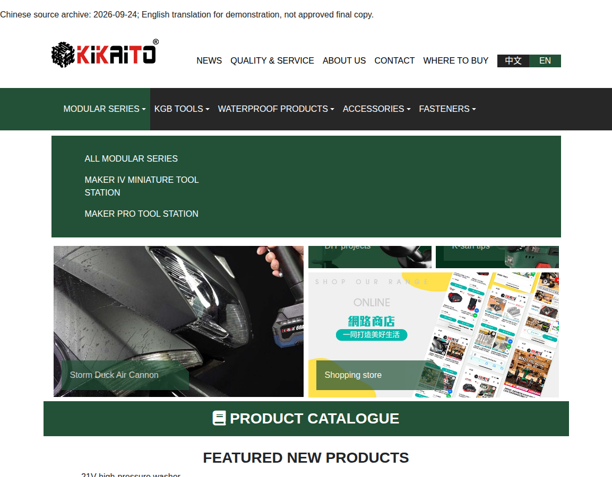

Caption: Modular Series menu open, desktop 1153px; demonstration 2026-11-03 | [#6](https://github.com/BTTSpace/KiKAiTO-client-communication/issues/6).

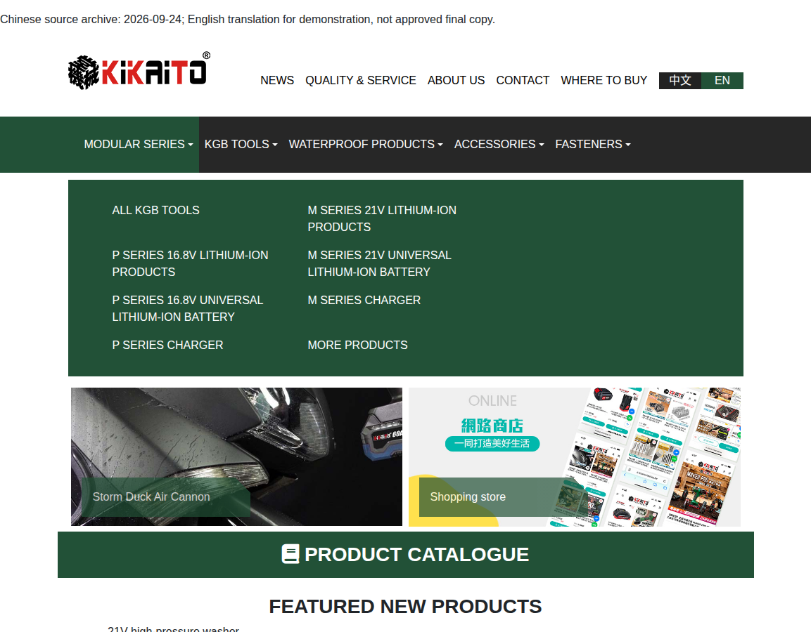

Caption: KGB Tools menu open, desktop 1153px; demonstration 2026-11-03 | [#6](https://github.com/BTTSpace/KiKAiTO-client-communication/issues/6).

Caption: Waterproof Products menu open, desktop 1153px; demonstration 2026-11-03 | [#6](https://github.com/BTTSpace/KiKAiTO-client-communication/issues/6).

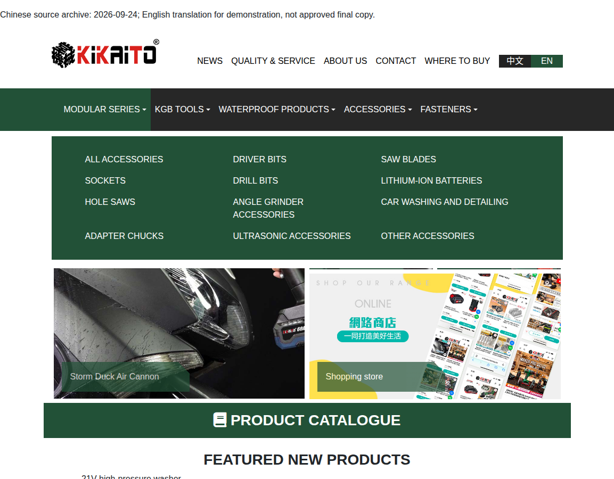

Caption: Accessories menu open, desktop 1153px; demonstration 2026-11-03 | [#6](https://github.com/BTTSpace/KiKAiTO-client-communication/issues/6).

Caption: Fasteners menu open, desktop 1153px; demonstration 2026-11-03 | [#6](https://github.com/BTTSpace/KiKAiTO-client-communication/issues/6).

The navigation views show the drawer open and closed at 390px and 991px, and the desktop navigation at 992px. The Fasteners views show the English menu open at 768px and 800px. The recordings show navigation and scrolling in each language. Demonstration 2026-11-03; source archive 2026-09-24; features [#6](https://github.com/BTTSpace/KiKAiTO-client-communication/issues/6), [#16](https://github.com/BTTSpace/KiKAiTO-client-communication/issues/16), [#18](https://github.com/BTTSpace/KiKAiTO-client-communication/issues/18).

Tablet navigation at 768, 800, 900 and 991px, demonstration 2026-11-03: Chinese 768px [closed](images/zh-nav-768-closed.png) / [open](images/zh-nav-768-open.png); Chinese 800px [closed](images/zh-nav-800-closed.png) / [open](images/zh-nav-800-open.png); Chinese 900px [closed](images/zh-nav-900-closed.png) / [open](images/zh-nav-900-open.png); Chinese 991px [closed](images/zh-nav-991-closed.png) / [open](images/zh-boundary-991.png); English 768px [closed](images/en-nav-768-closed.png) / [open](images/en-nav-768-open.png); English 800px [closed](images/en-nav-800-closed.png) / [open](images/en-nav-800-open.png); English 900px [closed](images/en-nav-900-closed.png) / [open](images/en-nav-900-open.png); English 991px [closed](images/en-nav-991-closed.png) / [open](images/en-boundary-991.png); [#5](https://github.com/BTTSpace/KiKAiTO-client-communication/issues/5), [#16](https://github.com/BTTSpace/KiKAiTO-client-communication/issues/16).

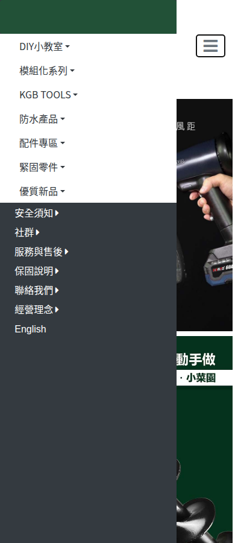

[Chinese navigation, mobile](recordings/zh-navigation-390.webm) | [English navigation, mobile](recordings/en-navigation-390.webm)

[Chinese tablet navigation, 800px](recordings/zh-tablet-navigation-800.webm) | [Chinese tablet navigation, 991px](recordings/zh-tablet-navigation-991.webm). The recordings show opening and closing a wrapped category menu; demonstration 2026-11-03.

[Chinese navigation, desktop](recordings/zh-navigation-992.webm) | [English navigation, desktop](recordings/en-navigation-992.webm)

Caption：English Fasteners menu open, 768px | Demonstration 2026-11-03; source archive 2026-09-24 | [#6](https://github.com/BTTSpace/KiKAiTO-client-communication/issues/6), [#13](https://github.com/BTTSpace/KiKAiTO-client-communication/issues/13)

Caption：English Fasteners menu open, 800px | Demonstration 2026-11-03; source archive 2026-09-24 | [#6](https://github.com/BTTSpace/KiKAiTO-client-communication/issues/6), [#13](https://github.com/BTTSpace/KiKAiTO-client-communication/issues/13)

Caption：Chinese homepage, 1440px | Demonstration 2026-11-03; source archive 2026-09-24 | [#6](https://github.com/BTTSpace/KiKAiTO-client-communication/issues/6), [#13](https://github.com/BTTSpace/KiKAiTO-client-communication/issues/13), [#16](https://github.com/BTTSpace/KiKAiTO-client-communication/issues/16), [#18](https://github.com/BTTSpace/KiKAiTO-client-communication/issues/18)

Caption：English homepage, 1440px | Demonstration 2026-11-03; source archive 2026-09-24 | [#6](https://github.com/BTTSpace/KiKAiTO-client-communication/issues/6), [#13](https://github.com/BTTSpace/KiKAiTO-client-communication/issues/13), [#16](https://github.com/BTTSpace/KiKAiTO-client-communication/issues/16), [#18](https://github.com/BTTSpace/KiKAiTO-client-communication/issues/18)

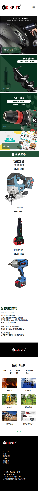

Caption：Chinese homepage, 390px | Demonstration 2026-11-03; source archive 2026-09-24 | [#6](https://github.com/BTTSpace/KiKAiTO-client-communication/issues/6), [#13](https://github.com/BTTSpace/KiKAiTO-client-communication/issues/13), [#16](https://github.com/BTTSpace/KiKAiTO-client-communication/issues/16), [#18](https://github.com/BTTSpace/KiKAiTO-client-communication/issues/18)

Caption：English homepage, 390px | Demonstration 2026-11-03; source archive 2026-09-24 | [#6](https://github.com/BTTSpace/KiKAiTO-client-communication/issues/6), [#13](https://github.com/BTTSpace/KiKAiTO-client-communication/issues/13), [#16](https://github.com/BTTSpace/KiKAiTO-client-communication/issues/16), [#18](https://github.com/BTTSpace/KiKAiTO-client-communication/issues/18)

Caption：Chinese KGB Tools menu open, 1440px | Demonstration 2026-11-03; source archive 2026-09-24 | [#6](https://github.com/BTTSpace/KiKAiTO-client-communication/issues/6), [#13](https://github.com/BTTSpace/KiKAiTO-client-communication/issues/13), [#16](https://github.com/BTTSpace/KiKAiTO-client-communication/issues/16), [#18](https://github.com/BTTSpace/KiKAiTO-client-communication/issues/18)

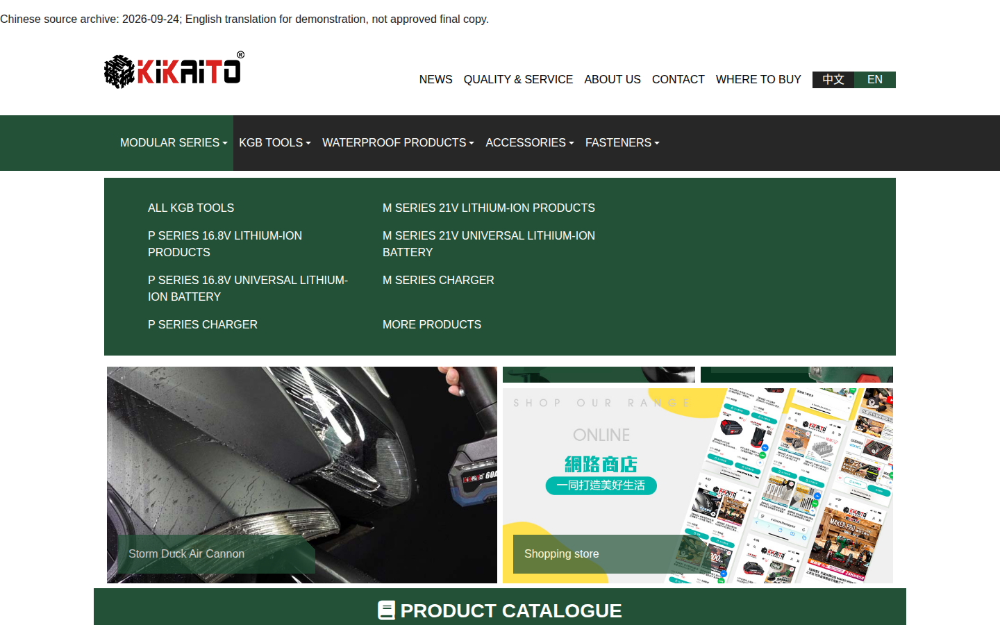

Caption：English KGB Tools menu open, 1440px | Demonstration 2026-11-03; source archive 2026-09-24 | [#6](https://github.com/BTTSpace/KiKAiTO-client-communication/issues/6), [#13](https://github.com/BTTSpace/KiKAiTO-client-communication/issues/13), [#16](https://github.com/BTTSpace/KiKAiTO-client-communication/issues/16), [#18](https://github.com/BTTSpace/KiKAiTO-client-communication/issues/18)

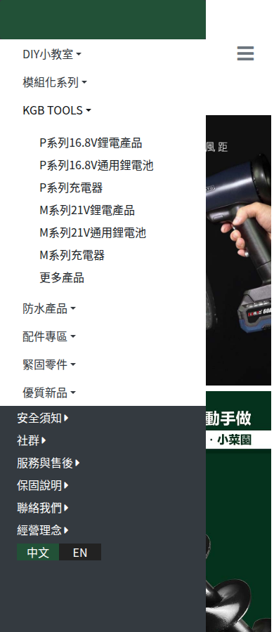

Caption：Chinese KGB Tools menu open, 390px | Demonstration 2026-11-03; source archive 2026-09-24 | [#6](https://github.com/BTTSpace/KiKAiTO-client-communication/issues/6), [#13](https://github.com/BTTSpace/KiKAiTO-client-communication/issues/13), [#16](https://github.com/BTTSpace/KiKAiTO-client-communication/issues/16), [#18](https://github.com/BTTSpace/KiKAiTO-client-communication/issues/18)

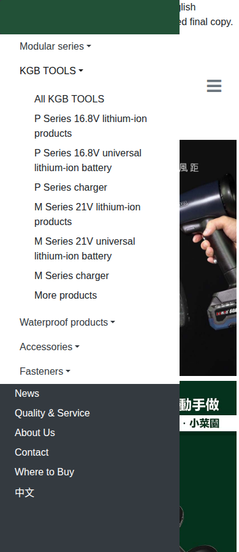

Caption：English KGB Tools menu open, 390px | Demonstration 2026-11-03; source archive 2026-09-24 | [#6](https://github.com/BTTSpace/KiKAiTO-client-communication/issues/6), [#13](https://github.com/BTTSpace/KiKAiTO-client-communication/issues/13), [#16](https://github.com/BTTSpace/KiKAiTO-client-communication/issues/16), [#18](https://github.com/BTTSpace/KiKAiTO-client-communication/issues/18)

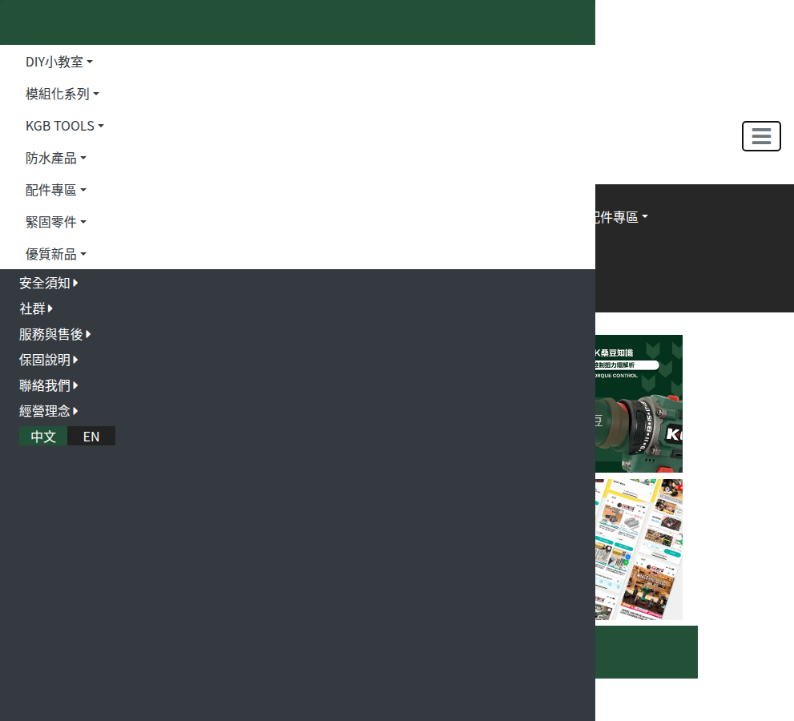

Caption：Chinese language entry, 991px, menu open | Demonstration 2026-11-03; source archive 2026-09-24 | [#6](https://github.com/BTTSpace/KiKAiTO-client-communication/issues/6), [#13](https://github.com/BTTSpace/KiKAiTO-client-communication/issues/13), [#16](https://github.com/BTTSpace/KiKAiTO-client-communication/issues/16), [#18](https://github.com/BTTSpace/KiKAiTO-client-communication/issues/18)

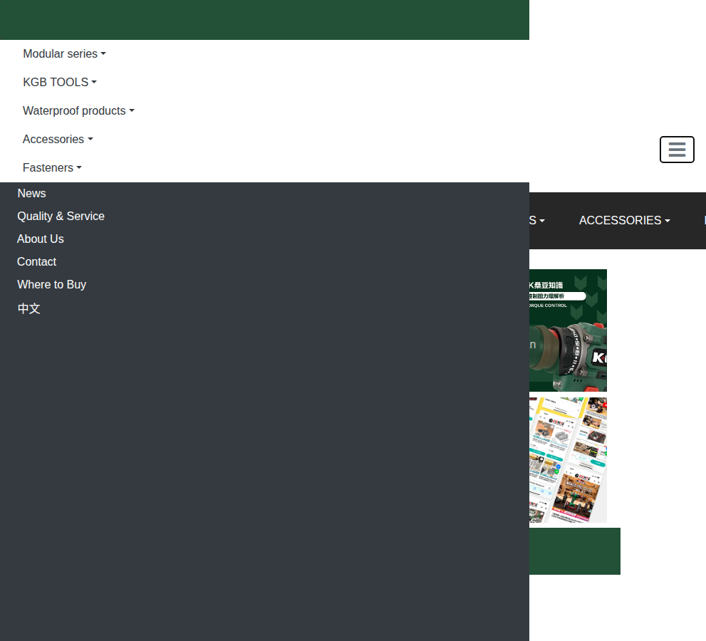

Caption：English language entry, 991px, menu open | Demonstration 2026-11-03; source archive 2026-09-24 | [#6](https://github.com/BTTSpace/KiKAiTO-client-communication/issues/6), [#13](https://github.com/BTTSpace/KiKAiTO-client-communication/issues/13), [#16](https://github.com/BTTSpace/KiKAiTO-client-communication/issues/16), [#18](https://github.com/BTTSpace/KiKAiTO-client-communication/issues/18)

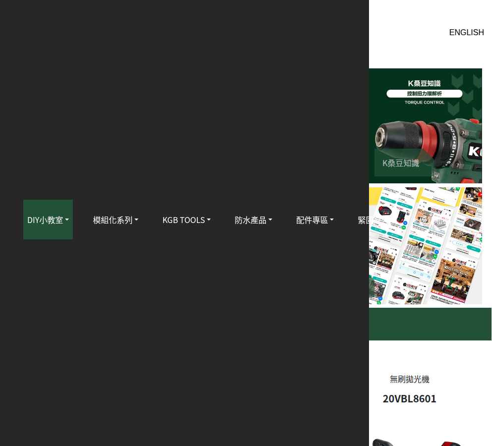

Caption：Chinese language entry, 992px | Demonstration 2026-11-03; source archive 2026-09-24 | [#6](https://github.com/BTTSpace/KiKAiTO-client-communication/issues/6), [#13](https://github.com/BTTSpace/KiKAiTO-client-communication/issues/13), [#16](https://github.com/BTTSpace/KiKAiTO-client-communication/issues/16), [#18](https://github.com/BTTSpace/KiKAiTO-client-communication/issues/18)

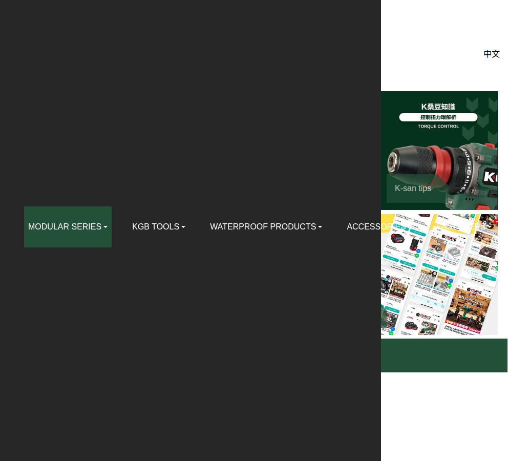

Caption：English language entry, 992px | Demonstration 2026-11-03; source archive 2026-09-24 | [#6](https://github.com/BTTSpace/KiKAiTO-client-communication/issues/6), [#13](https://github.com/BTTSpace/KiKAiTO-client-communication/issues/13), [#16](https://github.com/BTTSpace/KiKAiTO-client-communication/issues/16), [#18](https://github.com/BTTSpace/KiKAiTO-client-communication/issues/18)

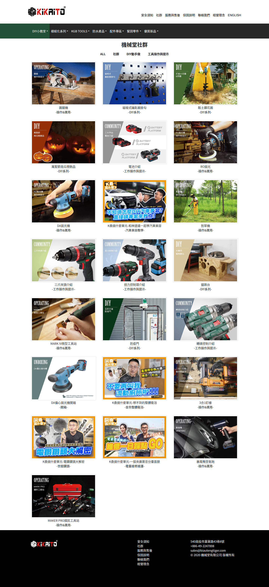

Caption：Chinese Community list, 1440px | Demonstration 2026-11-03; source archive 2026-09-24 | [#6](https://github.com/BTTSpace/KiKAiTO-client-communication/issues/6), [#13](https://github.com/BTTSpace/KiKAiTO-client-communication/issues/13), [#18](https://github.com/BTTSpace/KiKAiTO-client-communication/issues/18)

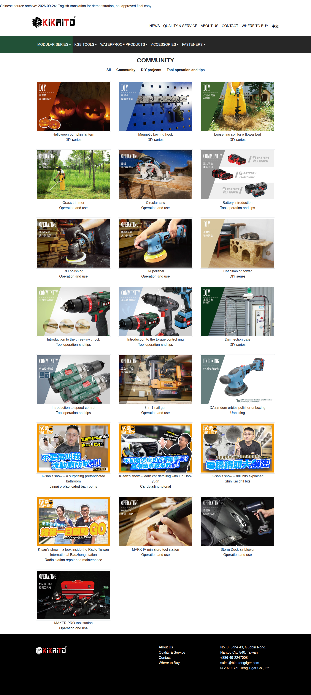

Caption：English Community list, 1440px | Demonstration 2026-11-03; source archive 2026-09-24 | [#6](https://github.com/BTTSpace/KiKAiTO-client-communication/issues/6), [#13](https://github.com/BTTSpace/KiKAiTO-client-communication/issues/13), [#18](https://github.com/BTTSpace/KiKAiTO-client-communication/issues/18)

Caption：Chinese Community list, 390px | Demonstration 2026-11-03; source archive 2026-09-24 | [#6](https://github.com/BTTSpace/KiKAiTO-client-communication/issues/6), [#13](https://github.com/BTTSpace/KiKAiTO-client-communication/issues/13), [#18](https://github.com/BTTSpace/KiKAiTO-client-communication/issues/18)

Caption：English Community list, 390px | Demonstration 2026-11-03; source archive 2026-09-24 | [#6](https://github.com/BTTSpace/KiKAiTO-client-communication/issues/6), [#13](https://github.com/BTTSpace/KiKAiTO-client-communication/issues/13), [#18](https://github.com/BTTSpace/KiKAiTO-client-communication/issues/18)

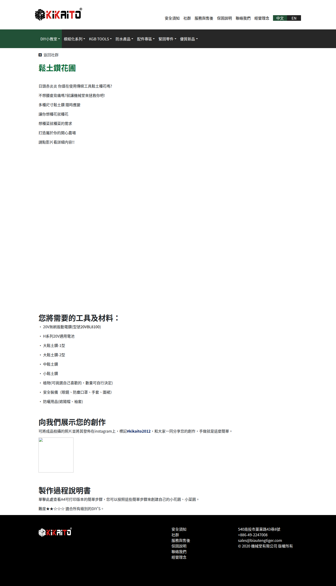

Caption：Chinese Community detail, 1440px | Demonstration 2026-11-03; source archive 2026-09-24 | [#6](https://github.com/BTTSpace/KiKAiTO-client-communication/issues/6), [#13](https://github.com/BTTSpace/KiKAiTO-client-communication/issues/13), [#18](https://github.com/BTTSpace/KiKAiTO-client-communication/issues/18)

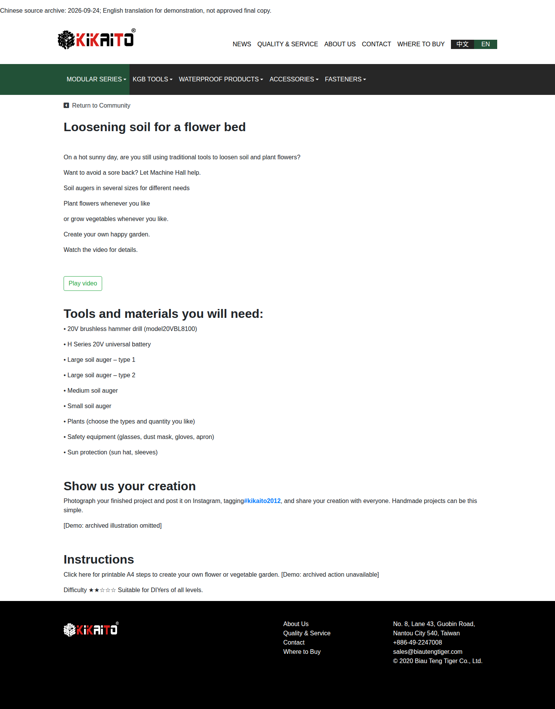

Caption：English Community detail, 1440px | Demonstration 2026-11-03; source archive 2026-09-24 | [#6](https://github.com/BTTSpace/KiKAiTO-client-communication/issues/6), [#13](https://github.com/BTTSpace/KiKAiTO-client-communication/issues/13), [#18](https://github.com/BTTSpace/KiKAiTO-client-communication/issues/18)

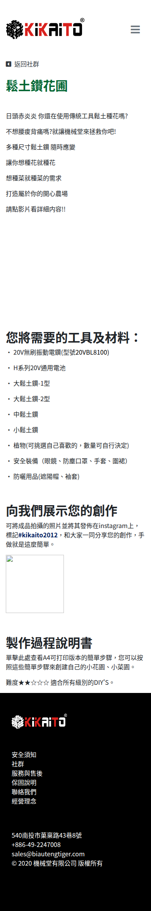

Caption：Chinese Community detail, 390px | Demonstration 2026-11-03; source archive 2026-09-24 | [#6](https://github.com/BTTSpace/KiKAiTO-client-communication/issues/6), [#13](https://github.com/BTTSpace/KiKAiTO-client-communication/issues/13), [#18](https://github.com/BTTSpace/KiKAiTO-client-communication/issues/18)

Caption：English Community detail, 390px | Demonstration 2026-11-03; source archive 2026-09-24 | [#6](https://github.com/BTTSpace/KiKAiTO-client-communication/issues/6), [#13](https://github.com/BTTSpace/KiKAiTO-client-communication/issues/13), [#18](https://github.com/BTTSpace/KiKAiTO-client-communication/issues/18)

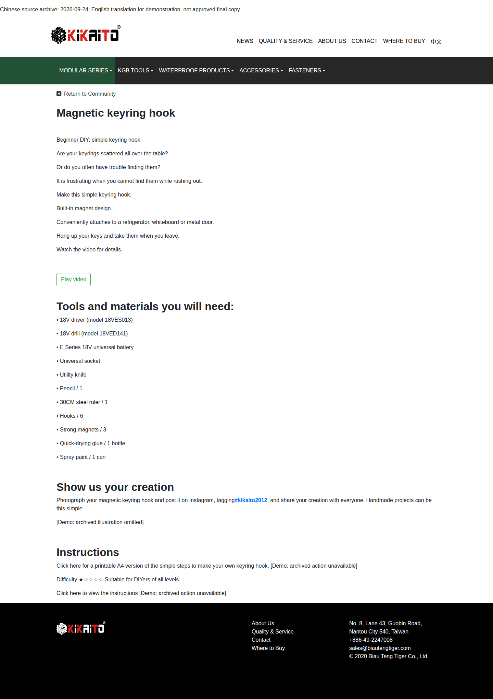

Caption：English article with unavailable action, 1440px | Demonstration 2026-11-03; source archive 2026-09-24 | [#6](https://github.com/BTTSpace/KiKAiTO-client-communication/issues/6), [#13](https://github.com/BTTSpace/KiKAiTO-client-communication/issues/13), [#18](https://github.com/BTTSpace/KiKAiTO-client-communication/issues/18)

[Community pages, desktop](recordings/community-desktop.webm) | Demonstration 2026-11-03; source archive 2026-09-24 | [#6](https://github.com/BTTSpace/KiKAiTO-client-communication/issues/6), [#13](https://github.com/BTTSpace/KiKAiTO-client-communication/issues/13), [#18](https://github.com/BTTSpace/KiKAiTO-client-communication/issues/18)

[Community pages, mobile](recordings/community-mobile.webm) | Demonstration 2026-11-03; source archive 2026-09-24 | [#6](https://github.com/BTTSpace/KiKAiTO-client-communication/issues/6), [#13](https://github.com/BTTSpace/KiKAiTO-client-communication/issues/13), [#18](https://github.com/BTTSpace/KiKAiTO-client-communication/issues/18)

中文說明（點此展開）

# 英文首頁展示，2026-11-03

[2026-11-03 展示圖片已完成檢查](https://github.com/BTTSpace/KiKAiTO-client-communication/pull/28#issuecomment-6607342732)。負責人回饋及客戶驗收尚待進行，歡迎客戶提出意見。工作完成並核對後，待客戶驗收不阻擋結案；請參閱[結案規則](../../../README.md)。展示中的中英文導覽位置已修正。英文首頁以完整中文首頁版面為基礎，使用英文內容並整合已核准的英文專屬區塊。可比較以下完整頁面的橫幅、產品型錄、精選商品、影片、Community，以及額外的英文 News 與分類。精選商品可能不同。

此展示使用 2026-09-24 中文來源封存：225 筆商品、1,079 張商品圖片及 22 篇 Community 文章。英文為示範翻譯，尚未核准為正式文案。部分原始圖片含中文字樣。封存不能代表目前正式網站內容；商品規格、安全與行銷敘述尚未驗證。歷史商業聯絡資料可能已失效，請勿用於實際聯絡。封存中有 103 個無法取得的內嵌檔案路徑，包括 98 個圖片路徑及五個 PDF 路徑。另外五項列印步驟引用有說明文字，但沒有來源連結；無法使用的項目會在文字旁標示。News、影片封面及經銷商包含示例資料。

每個中文訪客頁面均提供英文入口，每個英文訪客頁面均提供中文入口，桌機及手機皆可使用。在 Community 選擇類別或 More，開啟文章後可選 Return to Community 返回列表。選擇 Play video 可啟動 YouTube 影片，選擇可用的外部連結可開啟目的地。電子郵件詢價連結應包含正確的收件地址、主旨及內文。外部播放器或郵件應用程式的外觀或啟動不屬於視覺審閱範圍。

審閱時可由人員引導操作本機互動展示。顯示內容未受平板導覽與 News 日期修正影響的截圖及錄影，保留同日較早畫面。以下錄影為可下載檔案，並非內嵌播放器。較早的[英文預覽](../english-preview-2026-11-02/README.md)與[主題展示](../english-theme-preview-2026-11-03/README.md)為歷史紀錄，未呈現目前首頁版面。整體進度：[#2](https://github.com/BTTSpace/KiKAiTO-client-communication/issues/2), [#15](https://github.com/BTTSpace/KiKAiTO-client-communication/issues/15)。

## 動畫展示，2026-11-04

這些畫面呈現動畫修正後的英文首頁展示，視覺審閱尚待進行。瀏覽器在 1440 × 900 及 390 × 844 視窗模擬裝置設定，並非實體裝置。靜態圖片顯示第一張封面穩定後的畫面。錄影呈現從第一張切換至第二張封面；允許動畫時新封面淡入，減少動畫時直接顯示。以下標語錄影先捲至標語，再於該位置重新載入頁面：允許動畫時文字進場，減少動畫時直接顯示。首次從頁面頂端進入時，訪客捲到標語前動畫可能已結束。外部影片播放不在這些錄影範圍內。

標語重新載入錄影：[桌機，允許動畫](recordings/desktop-no-preference-reload.webm) · [桌機，減少動畫](recordings/desktop-reduce-reload.webm) · [手機，允許動畫](recordings/mobile-no-preference-reload.webm) · [手機，減少動畫](recordings/mobile-reduce-reload.webm)。

錄影：[桌機，允許動畫](recordings/desktop-no-preference.webm) · [桌機，減少動畫](recordings/desktop-reduce.webm) · [手機，允許動畫](recordings/mobile-no-preference.webm) · [手機，減少動畫](recordings/mobile-reduce.webm)。客戶回饋及驗收尚待進行。

## 畫面與錄影

語言切換同時顯示中文與 EN，並標示目前語言。以滑鼠或鍵盤選擇另一語言可開啟其首頁。英文商品選單每欄文字靠左對齊，且對應列保持對齊。下方五組桌機畫面為 1153px 的精簡語言切換展示；第二張為 KGB Tools。展示日期 2026-11-03 | [#6](https://github.com/BTTSpace/KiKAiTO-client-communication/issues/6)、[#16](https://github.com/BTTSpace/KiKAiTO-client-communication/issues/16)。

語言切換錄影，展示日期 2026-11-03：中文切換至英文：[手機點選](recordings/language-zh-390-click.webm)、[手機鍵盤](recordings/language-zh-390-keyboard.webm)、[桌機點選](recordings/language-zh-1153-click.webm)、[桌機鍵盤](recordings/language-zh-1153-keyboard.webm)。英文切換至中文：[手機點選](recordings/language-en-390-click.webm)、[手機鍵盤](recordings/language-en-390-keyboard.webm)、[桌機點選](recordings/language-en-1153-click.webm)、[桌機鍵盤](recordings/language-en-1153-keyboard.webm)。[#16](https://github.com/BTTSpace/KiKAiTO-client-communication/issues/16)

圖說：Modular Series 選單展開，桌機 1153px；展示日期 2026-11-03 | [#6](https://github.com/BTTSpace/KiKAiTO-client-communication/issues/6)。

圖說：KGB Tools 選單展開，桌機 1153px；展示日期 2026-11-03 | [#6](https://github.com/BTTSpace/KiKAiTO-client-communication/issues/6)。

圖說：Waterproof Products 選單展開，桌機 1153px；展示日期 2026-11-03 | [#6](https://github.com/BTTSpace/KiKAiTO-client-communication/issues/6)。

圖說：Accessories 選單展開，桌機 1153px；展示日期 2026-11-03 | [#6](https://github.com/BTTSpace/KiKAiTO-client-communication/issues/6)。

圖說：Fasteners 選單展開，桌機 1153px；展示日期 2026-11-03 | [#6](https://github.com/BTTSpace/KiKAiTO-client-communication/issues/6)。

導覽畫面顯示 390px 及 991px 的選單展開與收合，以及 992px 的桌機導覽。Fasteners 畫面顯示英文選單在 768px 及 800px 展開的狀態。錄影顯示各語言的導覽與捲動畫面。展示 2026-11-03；來源封存 2026-09-24；功能 [#6](https://github.com/BTTSpace/KiKAiTO-client-communication/issues/6)、[#16](https://github.com/BTTSpace/KiKAiTO-client-communication/issues/16)、[#18](https://github.com/BTTSpace/KiKAiTO-client-communication/issues/18)。

768、800、900 及 991px 平板導覽，展示日期 2026-11-03：中文 768px [收合](images/zh-nav-768-closed.png)／[展開](images/zh-nav-768-open.png)；中文 800px [收合](images/zh-nav-800-closed.png)／[展開](images/zh-nav-800-open.png)；中文 900px [收合](images/zh-nav-900-closed.png)／[展開](images/zh-nav-900-open.png)；中文 991px [收合](images/zh-nav-991-closed.png)／[展開](images/zh-boundary-991.png)；英文 768px [收合](images/en-nav-768-closed.png)／[展開](images/en-nav-768-open.png)；英文 800px [收合](images/en-nav-800-closed.png)／[展開](images/en-nav-800-open.png)；英文 900px [收合](images/en-nav-900-closed.png)／[展開](images/en-nav-900-open.png)；英文 991px [收合](images/en-nav-991-closed.png)／[展開](images/en-boundary-991.png)；[#5](https://github.com/BTTSpace/KiKAiTO-client-communication/issues/5)、[#16](https://github.com/BTTSpace/KiKAiTO-client-communication/issues/16)。

[中文導覽，手機](recordings/zh-navigation-390.webm) | [英文導覽，手機](recordings/en-navigation-390.webm)

[中文平板導覽，800px](recordings/zh-tablet-navigation-800.webm) | [中文平板導覽，991px](recordings/zh-tablet-navigation-991.webm)。錄影呈現換列後分類選單的開啟與關閉；展示日期 2026-11-03。

[中文導覽，桌機](recordings/zh-navigation-992.webm) | [英文導覽，桌機](recordings/en-navigation-992.webm)

圖說：英文 Fasteners 選單展開，768px | 展示 2026-11-03；來源封存 2026-09-24 | [#6](https://github.com/BTTSpace/KiKAiTO-client-communication/issues/6), [#13](https://github.com/BTTSpace/KiKAiTO-client-communication/issues/13)

圖說：英文 Fasteners 選單展開，800px | 展示 2026-11-03；來源封存 2026-09-24 | [#6](https://github.com/BTTSpace/KiKAiTO-client-communication/issues/6), [#13](https://github.com/BTTSpace/KiKAiTO-client-communication/issues/13)

圖說：中文首頁，1440px | 展示 2026-11-03；來源封存 2026-09-24 | [#6](https://github.com/BTTSpace/KiKAiTO-client-communication/issues/6), [#13](https://github.com/BTTSpace/KiKAiTO-client-communication/issues/13), [#16](https://github.com/BTTSpace/KiKAiTO-client-communication/issues/16), [#18](https://github.com/BTTSpace/KiKAiTO-client-communication/issues/18)

圖說：英文首頁，1440px | 展示 2026-11-03；來源封存 2026-09-24 | [#6](https://github.com/BTTSpace/KiKAiTO-client-communication/issues/6), [#13](https://github.com/BTTSpace/KiKAiTO-client-communication/issues/13), [#16](https://github.com/BTTSpace/KiKAiTO-client-communication/issues/16), [#18](https://github.com/BTTSpace/KiKAiTO-client-communication/issues/18)

圖說：中文首頁，390px | 展示 2026-11-03；來源封存 2026-09-24 | [#6](https://github.com/BTTSpace/KiKAiTO-client-communication/issues/6), [#13](https://github.com/BTTSpace/KiKAiTO-client-communication/issues/13), [#16](https://github.com/BTTSpace/KiKAiTO-client-communication/issues/16), [#18](https://github.com/BTTSpace/KiKAiTO-client-communication/issues/18)

圖說：英文首頁，390px | 展示 2026-11-03；來源封存 2026-09-24 | [#6](https://github.com/BTTSpace/KiKAiTO-client-communication/issues/6), [#13](https://github.com/BTTSpace/KiKAiTO-client-communication/issues/13), [#16](https://github.com/BTTSpace/KiKAiTO-client-communication/issues/16), [#18](https://github.com/BTTSpace/KiKAiTO-client-communication/issues/18)

圖說：中文 KGB Tools 選單展開，1440px | 展示 2026-11-03；來源封存 2026-09-24 | [#6](https://github.com/BTTSpace/KiKAiTO-client-communication/issues/6), [#13](https://github.com/BTTSpace/KiKAiTO-client-communication/issues/13), [#16](https://github.com/BTTSpace/KiKAiTO-client-communication/issues/16), [#18](https://github.com/BTTSpace/KiKAiTO-client-communication/issues/18)

圖說：英文 KGB Tools 選單展開，1440px | 展示 2026-11-03；來源封存 2026-09-24 | [#6](https://github.com/BTTSpace/KiKAiTO-client-communication/issues/6), [#13](https://github.com/BTTSpace/KiKAiTO-client-communication/issues/13), [#16](https://github.com/BTTSpace/KiKAiTO-client-communication/issues/16), [#18](https://github.com/BTTSpace/KiKAiTO-client-communication/issues/18)

圖說：中文 KGB Tools 選單展開，390px | 展示 2026-11-03；來源封存 2026-09-24 | [#6](https://github.com/BTTSpace/KiKAiTO-client-communication/issues/6), [#13](https://github.com/BTTSpace/KiKAiTO-client-communication/issues/13), [#16](https://github.com/BTTSpace/KiKAiTO-client-communication/issues/16), [#18](https://github.com/BTTSpace/KiKAiTO-client-communication/issues/18)

圖說：英文 KGB Tools 選單展開，390px | 展示 2026-11-03；來源封存 2026-09-24 | [#6](https://github.com/BTTSpace/KiKAiTO-client-communication/issues/6), [#13](https://github.com/BTTSpace/KiKAiTO-client-communication/issues/13), [#16](https://github.com/BTTSpace/KiKAiTO-client-communication/issues/16), [#18](https://github.com/BTTSpace/KiKAiTO-client-communication/issues/18)

圖說：中文語言入口，991px，選單展開 | 展示 2026-11-03；來源封存 2026-09-24 | [#6](https://github.com/BTTSpace/KiKAiTO-client-communication/issues/6), [#13](https://github.com/BTTSpace/KiKAiTO-client-communication/issues/13), [#16](https://github.com/BTTSpace/KiKAiTO-client-communication/issues/16), [#18](https://github.com/BTTSpace/KiKAiTO-client-communication/issues/18)

圖說：英文語言入口，991px，選單展開 | 展示 2026-11-03；來源封存 2026-09-24 | [#6](https://github.com/BTTSpace/KiKAiTO-client-communication/issues/6), [#13](https://github.com/BTTSpace/KiKAiTO-client-communication/issues/13), [#16](https://github.com/BTTSpace/KiKAiTO-client-communication/issues/16), [#18](https://github.com/BTTSpace/KiKAiTO-client-communication/issues/18)

圖說：中文語言入口，992px | 展示 2026-11-03；來源封存 2026-09-24 | [#6](https://github.com/BTTSpace/KiKAiTO-client-communication/issues/6), [#13](https://github.com/BTTSpace/KiKAiTO-client-communication/issues/13), [#16](https://github.com/BTTSpace/KiKAiTO-client-communication/issues/16), [#18](https://github.com/BTTSpace/KiKAiTO-client-communication/issues/18)

圖說：英文語言入口，992px | 展示 2026-11-03；來源封存 2026-09-24 | [#6](https://github.com/BTTSpace/KiKAiTO-client-communication/issues/6), [#13](https://github.com/BTTSpace/KiKAiTO-client-communication/issues/13), [#16](https://github.com/BTTSpace/KiKAiTO-client-communication/issues/16), [#18](https://github.com/BTTSpace/KiKAiTO-client-communication/issues/18)

圖說：中文 Community 列表，1440px | 展示 2026-11-03；來源封存 2026-09-24 | [#6](https://github.com/BTTSpace/KiKAiTO-client-communication/issues/6), [#13](https://github.com/BTTSpace/KiKAiTO-client-communication/issues/13), [#18](https://github.com/BTTSpace/KiKAiTO-client-communication/issues/18)

圖說：英文 Community 列表，1440px | 展示 2026-11-03；來源封存 2026-09-24 | [#6](https://github.com/BTTSpace/KiKAiTO-client-communication/issues/6), [#13](https://github.com/BTTSpace/KiKAiTO-client-communication/issues/13), [#18](https://github.com/BTTSpace/KiKAiTO-client-communication/issues/18)

圖說：中文 Community 列表，390px | 展示 2026-11-03；來源封存 2026-09-24 | [#6](https://github.com/BTTSpace/KiKAiTO-client-communication/issues/6), [#13](https://github.com/BTTSpace/KiKAiTO-client-communication/issues/13), [#18](https://github.com/BTTSpace/KiKAiTO-client-communication/issues/18)

圖說：英文 Community 列表，390px | 展示 2026-11-03；來源封存 2026-09-24 | [#6](https://github.com/BTTSpace/KiKAiTO-client-communication/issues/6), [#13](https://github.com/BTTSpace/KiKAiTO-client-communication/issues/13), [#18](https://github.com/BTTSpace/KiKAiTO-client-communication/issues/18)

圖說：中文 Community 文章，1440px | 展示 2026-11-03；來源封存 2026-09-24 | [#6](https://github.com/BTTSpace/KiKAiTO-client-communication/issues/6), [#13](https://github.com/BTTSpace/KiKAiTO-client-communication/issues/13), [#18](https://github.com/BTTSpace/KiKAiTO-client-communication/issues/18)

圖說：英文 Community 文章，1440px | 展示 2026-11-03；來源封存 2026-09-24 | [#6](https://github.com/BTTSpace/KiKAiTO-client-communication/issues/6), [#13](https://github.com/BTTSpace/KiKAiTO-client-communication/issues/13), [#18](https://github.com/BTTSpace/KiKAiTO-client-communication/issues/18)

圖說：中文 Community 文章，390px | 展示 2026-11-03；來源封存 2026-09-24 | [#6](https://github.com/BTTSpace/KiKAiTO-client-communication/issues/6), [#13](https://github.com/BTTSpace/KiKAiTO-client-communication/issues/13), [#18](https://github.com/BTTSpace/KiKAiTO-client-communication/issues/18)

圖說：英文 Community 文章，390px | 展示 2026-11-03；來源封存 2026-09-24 | [#6](https://github.com/BTTSpace/KiKAiTO-client-communication/issues/6), [#13](https://github.com/BTTSpace/KiKAiTO-client-communication/issues/13), [#18](https://github.com/BTTSpace/KiKAiTO-client-communication/issues/18)

圖說：英文文章中無法使用的項目，1440px | 展示 2026-11-03；來源封存 2026-09-24 | [#6](https://github.com/BTTSpace/KiKAiTO-client-communication/issues/6), [#13](https://github.com/BTTSpace/KiKAiTO-client-communication/issues/13), [#18](https://github.com/BTTSpace/KiKAiTO-client-communication/issues/18)

[Community 頁面，桌機](recordings/community-desktop.webm) | 展示 2026-11-03；來源封存 2026-09-24 | [#6](https://github.com/BTTSpace/KiKAiTO-client-communication/issues/6), [#13](https://github.com/BTTSpace/KiKAiTO-client-communication/issues/13), [#18](https://github.com/BTTSpace/KiKAiTO-client-communication/issues/18)

[Community 頁面，手機](recordings/community-mobile.webm) | 展示 2026-11-03；來源封存 2026-09-24 | [#6](https://github.com/BTTSpace/KiKAiTO-client-communication/issues/6), [#13](https://github.com/BTTSpace/KiKAiTO-client-communication/issues/13), [#18](https://github.com/BTTSpace/KiKAiTO-client-communication/issues/18)

