> 2026-11-03: This historical preview uses an earlier theme. See the [corrected theme demonstration](../english-theme-preview-2026-11-03/README.md); acceptance remains pending.

# English preview 2026-11-02

Chinese source archive: **2026-09-24**. The English text is a demonstration translation, not approved final copy. This archive cannot establish what is currently on the live website. The original images may contain Chinese lettering and product model/SKU fields may remain Chinese. Product specifications, safety and marketing claims have not been independently verified. Archived contact phone numbers and addresses are historical source values and have not been verified as current; do not rely on this preview for live contact.

The preview contains 225 translated source products and reuses 1,079 source product images. It omits 103 unique archived inline illustrations. Videos, News notices and distributor entries marked DEMO are separate illustrative examples; sample distributors are not real. Customer review and acceptance remain pending. Actual email application composition, remote YouTube playback and external phone/email app launch remain unverified. No email was sent.

[Demo and feedback](https://github.com/BTTSpace/KiKAiTO-client-communication/issues/15).

## Homepage and navigation

Customer features: [#6](https://github.com/BTTSpace/KiKAiTO-client-communication/issues/6), [#13](https://github.com/BTTSpace/KiKAiTO-client-communication/issues/13), [#16](https://github.com/BTTSpace/KiKAiTO-client-communication/issues/16), [#18](https://github.com/BTTSpace/KiKAiTO-client-communication/issues/18).

Desktop and mobile views show the English homepage and its navigation. Featured products are demonstration selections from the translated archive, not claims about historical featured products.

Screen state: English preview 2026-11-02, showing published content or staff preview as described below.

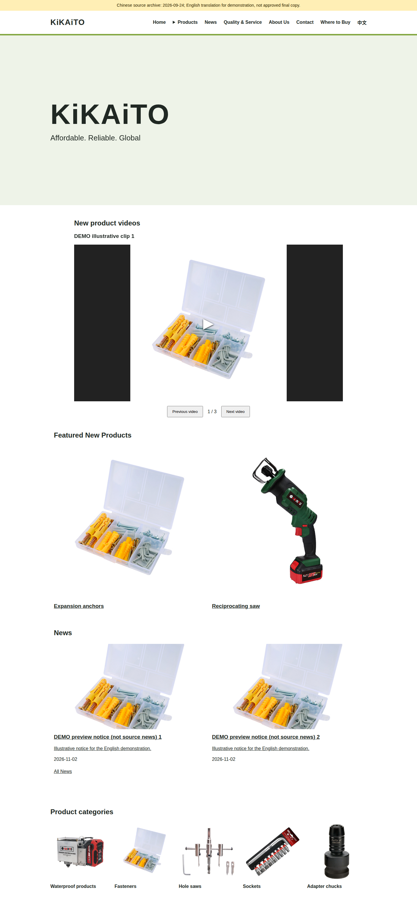

Caption: Desktop homepage | English preview 2026-11-02

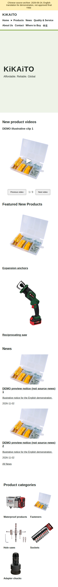

Caption: Mobile homepage | English preview 2026-11-02

- [Desktop: homepage, category, product, News, information, directory and Chinese return](video/final-visitor-desktop.mp4)
- [Mobile: the same visitor journey](video/final-visitor-mobile.mp4)

## Video covers and motion

Customer features: [#6](https://github.com/BTTSpace/KiKAiTO-client-communication/issues/6), [#13](https://github.com/BTTSpace/KiKAiTO-client-communication/issues/13), [#18](https://github.com/BTTSpace/KiKAiTO-client-communication/issues/18).

The three covers are illustrative Demo clips, not archived company videos. Recordings show each clip playing and being paused with the keyboard, with browser-emulated reduced motion on and off. The unavailable-video state is simulated.

Screen state: English preview 2026-11-02, showing published content or staff preview as described below.

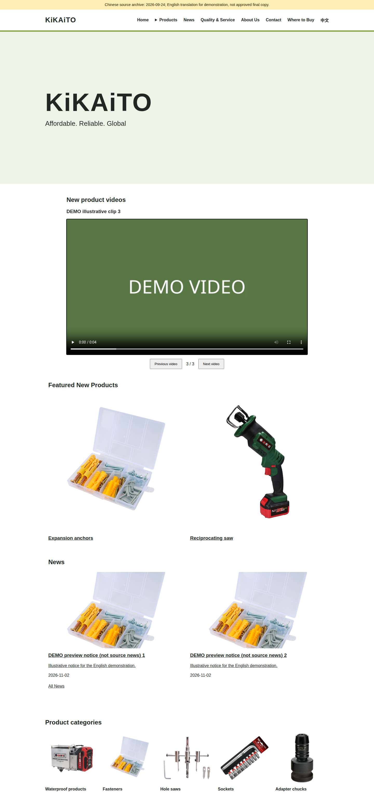

Caption: Desktop, normal motion | English preview 2026-11-02

Caption: Desktop, reduced motion | English preview 2026-11-02

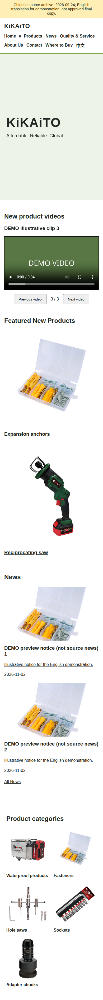

Caption: Mobile, normal motion | English preview 2026-11-02

Caption: Mobile, reduced motion | English preview 2026-11-02

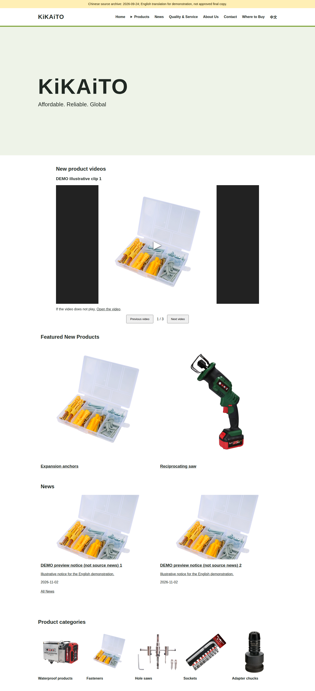

Caption: Simulated playback failure | English preview 2026-11-02

Caption: Illustrative video title editor | English preview 2026-11-02

- [Desktop, normal motion: play and pause three illustrative clips](video/final-video-desktop-no-preference.mp4)
- [Desktop, reduced motion: play and pause](video/final-video-desktop-reduce.mp4)
- [Mobile, normal motion: play and pause](video/final-video-mobile-no-preference.mp4)
- [Mobile, reduced motion: play and pause](video/final-video-mobile-reduce.mp4)
- [Simulated unavailable video](video/final-video-failure.mp4)
- [Administrator saves an illustrative video draft, compares preview and public page, then publishes and unpublishes](video/final-admin-video.mp4)

## Products and categories

Customer features: [#4](https://github.com/BTTSpace/KiKAiTO-client-communication/issues/4), [#7](https://github.com/BTTSpace/KiKAiTO-client-communication/issues/7), [#11](https://github.com/BTTSpace/KiKAiTO-client-communication/issues/11), [#12](https://github.com/BTTSpace/KiKAiTO-client-communication/issues/12).

The category and product use translated archive content. The administration recordings show a temporary, explicitly labelled non-archive product and categories, as well as the archived product’s draft, preview, publication, image change and unpublication. The temporary product and categories were removed after the recording. One unrelated product visible in a category has a conflicting archived name and description; its specifications require verification.

Screen state: English preview 2026-11-02, showing published content or staff preview as described below.

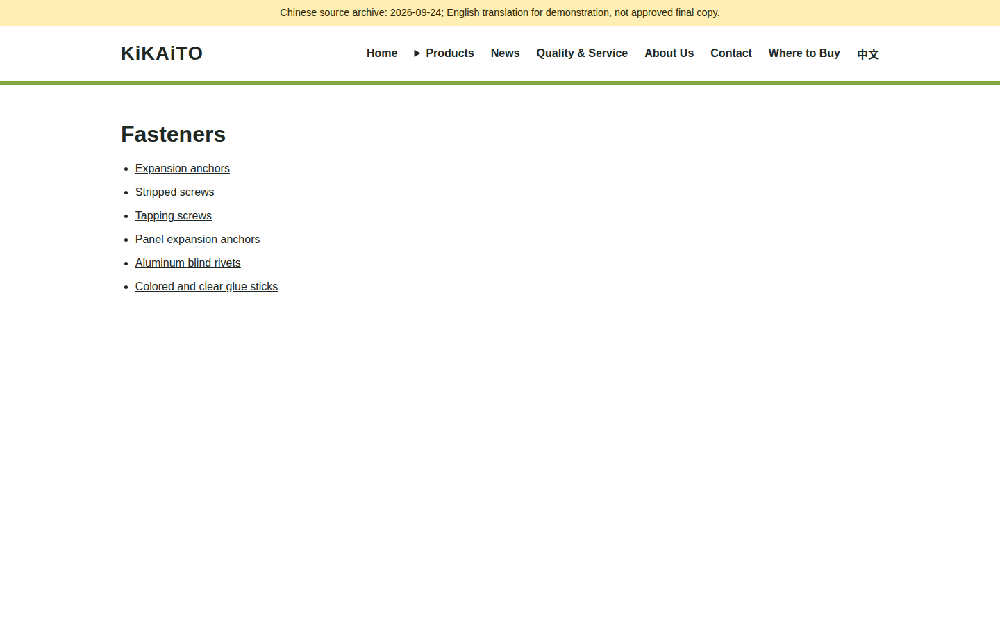

Caption: Desktop category | English preview 2026-11-02

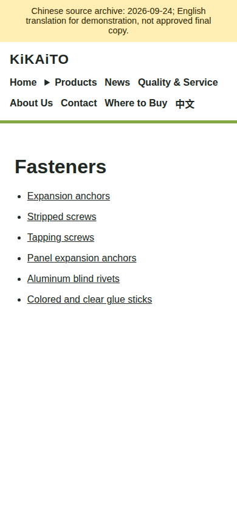

Caption: Mobile category | English preview 2026-11-02

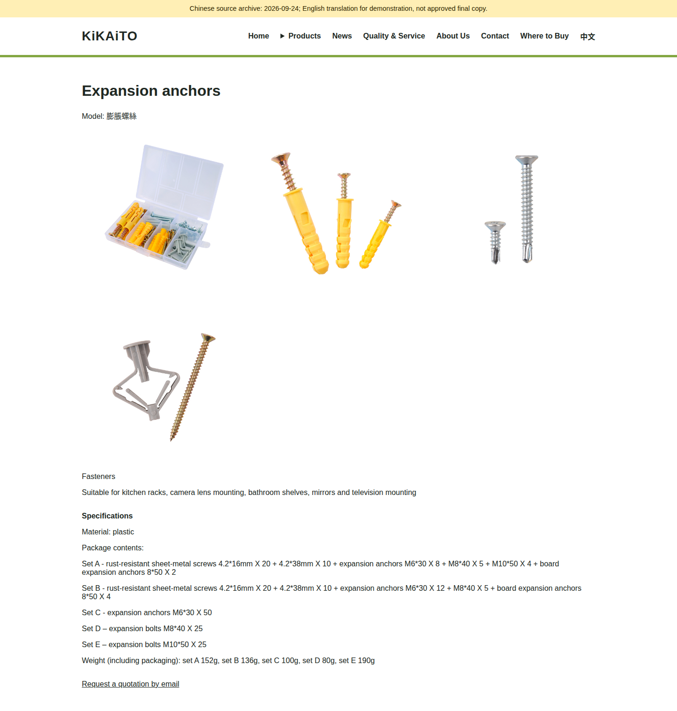

Caption: Desktop product | English preview 2026-11-02

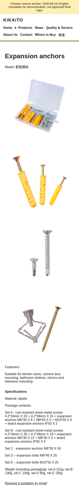

Caption: Mobile product | English preview 2026-11-02

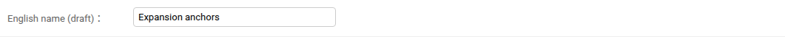

Caption: Product English draft field | English preview 2026-11-02

Caption: English category editor | English preview 2026-11-02

- [Create temporary illustrative main and subcategories and one bilingual product, preview and publish to both categories](video/final-admin-create.mp4)
- [Change product text and category: staff preview shows the draft while public pages retain the published version until publication](video/final-admin-category-draft.mp4)
- [Upload a temporary illustrative image: preview, compare the public version, publish and restore the original images](video/final-admin-image.mp4)
- [Unpublish the product: homepage and category hide it; the product is then republished](video/final-admin-product-unpublish.mp4)

## Featured products and category icons

Customer features: [#6](https://github.com/BTTSpace/KiKAiTO-client-communication/issues/6), [#12](https://github.com/BTTSpace/KiKAiTO-client-communication/issues/12), [#13](https://github.com/BTTSpace/KiKAiTO-client-communication/issues/13).

The homepage uses two archive products selected for demonstration and translated category icons. Recordings show preview and publication of order and icon changes, plus removing and restoring a featured selection.

Screen state: English preview 2026-11-02, showing published content or staff preview as described below.

Caption: Featured selection field | English preview 2026-11-02

Caption: Category icon title field | English preview 2026-11-02

- [Change the order of two featured products: preview, old public order, publication and restoration](video/final-admin-featured-order.mp4)
- [Remove a featured selection while keeping its product page available](video/final-admin-featured-toggle.mp4)
- [Edit a category icon: draft preview, public old version, publish and unpublish](video/final-admin-icon.mp4)

## News

Customer features: [#8](https://github.com/BTTSpace/KiKAiTO-client-communication/issues/8), [#13](https://github.com/BTTSpace/KiKAiTO-client-communication/issues/13), [#18](https://github.com/BTTSpace/KiKAiTO-client-communication/issues/18).

The notices are explicitly labelled illustrative Demo content, not archived news or company events.

Screen state: English preview 2026-11-02, showing published content or staff preview as described below.

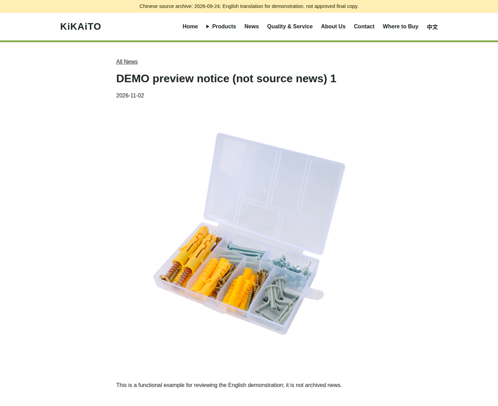

Caption: Illustrative notice, desktop | English preview 2026-11-02

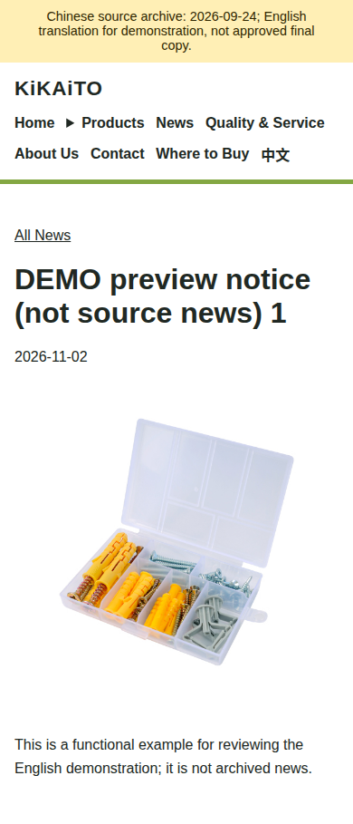

Caption: Illustrative notice, mobile | English preview 2026-11-02

Caption: Illustrative News title field | English preview 2026-11-02

- [Edit an illustrative notice, compare staff preview with the published article, then publish and unpublish](video/final-admin-news.mp4)

## Information pages

Customer features: [#9](https://github.com/BTTSpace/KiKAiTO-client-communication/issues/9), [#14](https://github.com/BTTSpace/KiKAiTO-client-communication/issues/14).

Quality & Service, About Us and Contact use translated archive content. The recordings use clearly labelled temporary illustrative edits and restore the original English content.

Screen state: English preview 2026-11-02, showing published content or staff preview as described below.

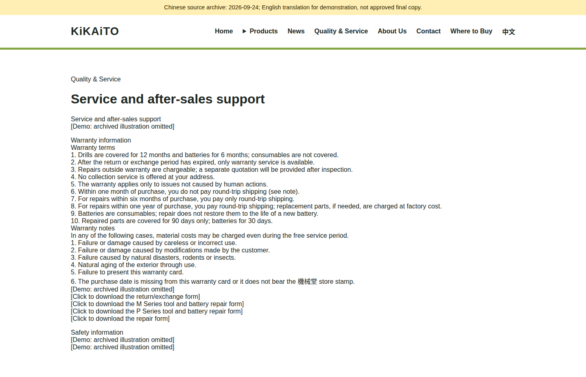

Caption: Quality & Service, desktop | English preview 2026-11-02

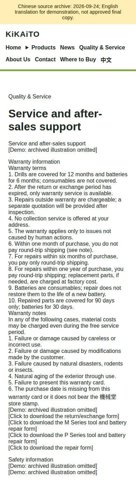

Caption: Quality & Service, mobile | English preview 2026-11-02

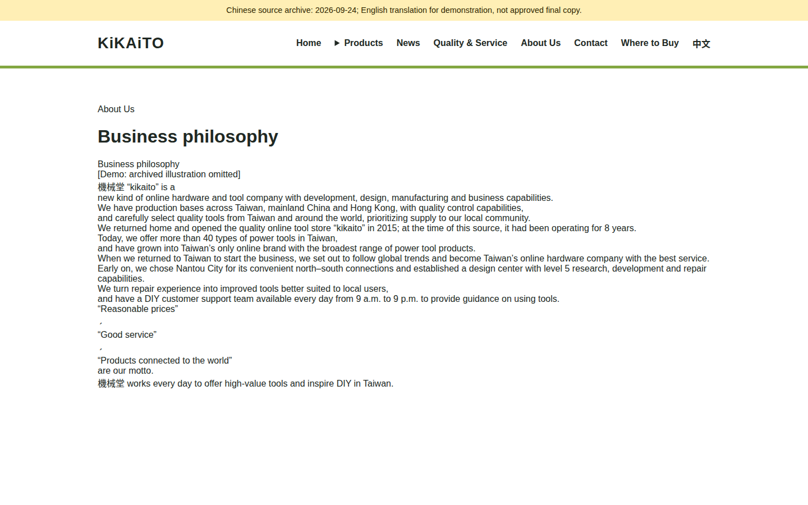

Caption: About Us, desktop | English preview 2026-11-02

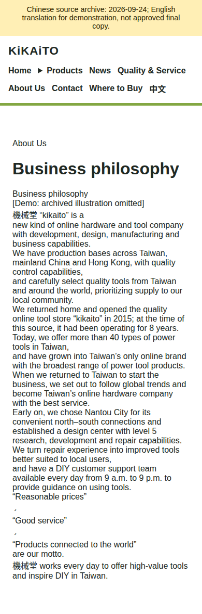

Caption: About Us, mobile | English preview 2026-11-02

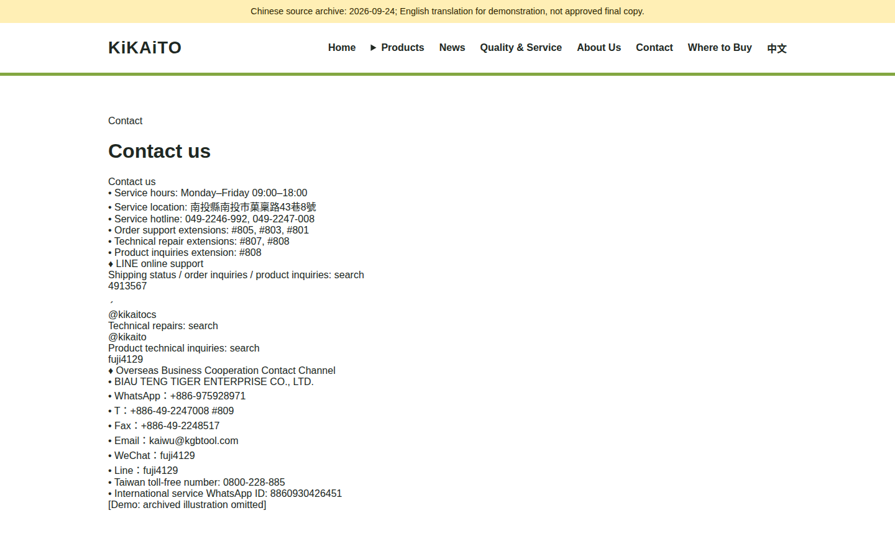

Caption: Contact, desktop | English preview 2026-11-02

Caption: Contact, mobile | English preview 2026-11-02

Caption: Information editor content field | English preview 2026-11-02

- [Edit English in the linked bilingual editor, preview and publish, then check that the Chinese page is unchanged](video/final-admin-bilingual-info.mp4)
- [Temporarily edit, preview and publish Quality & Service text, then restore it](video/final-admin-quality-service.mp4)
- [Temporarily edit, preview and publish Contact text, then restore it](video/final-admin-contact.mp4)
- [Unpublish and republish the English information page](video/final-admin-information-unpublish.mp4)

## Quotation by email

Customer features: [#7](https://github.com/BTTSpace/KiKAiTO-client-communication/issues/7), [#10](https://github.com/BTTSpace/KiKAiTO-client-communication/issues/10).

The product page provides an email quotation link. The administrator changes a Demo recipient, and the link is checked for the new address. Opening a real email application has not been demonstrated; no email was sent.

Screen state: English preview 2026-11-02, showing published content or staff preview as described below.

Caption: Product quotation entry, desktop | English preview 2026-11-02

Caption: Product quotation entry, mobile | English preview 2026-11-02

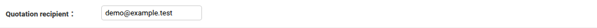

Caption: Demo recipient setting | English preview 2026-11-02

- [Change the Demo recipient and return to the product quotation entry](video/final-admin-recipient.mp4)

## Where to Buy

Customer features: [#17](https://github.com/BTTSpace/KiKAiTO-client-communication/issues/17), [#18](https://github.com/BTTSpace/KiKAiTO-client-communication/issues/18).

All listed distributors are illustrative examples, explicitly labelled as not real. Their addresses and contact details are examples.

Screen state: English preview 2026-11-02, showing published content or staff preview as described below.

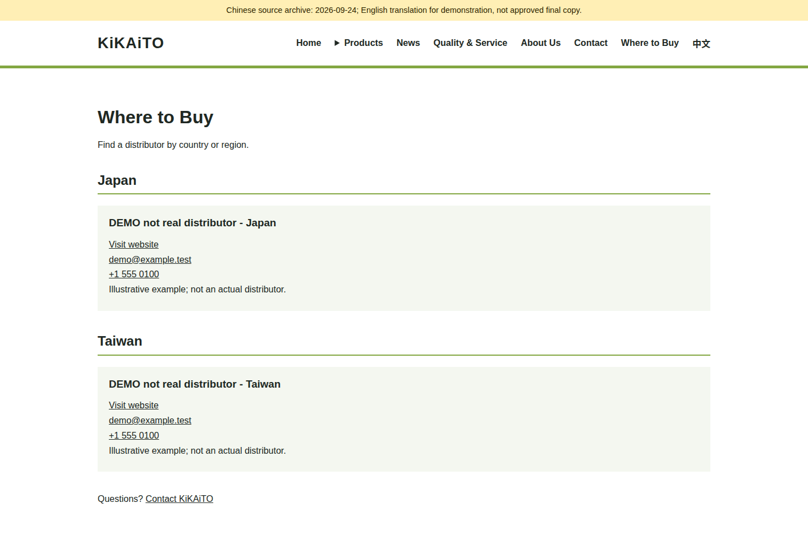

Caption: Illustrative directory, desktop | English preview 2026-11-02

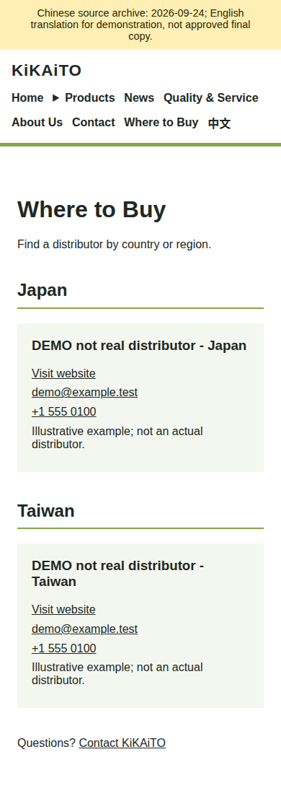

Caption: Illustrative directory, mobile | English preview 2026-11-02

Caption: Illustrative distributor editor | English preview 2026-11-02

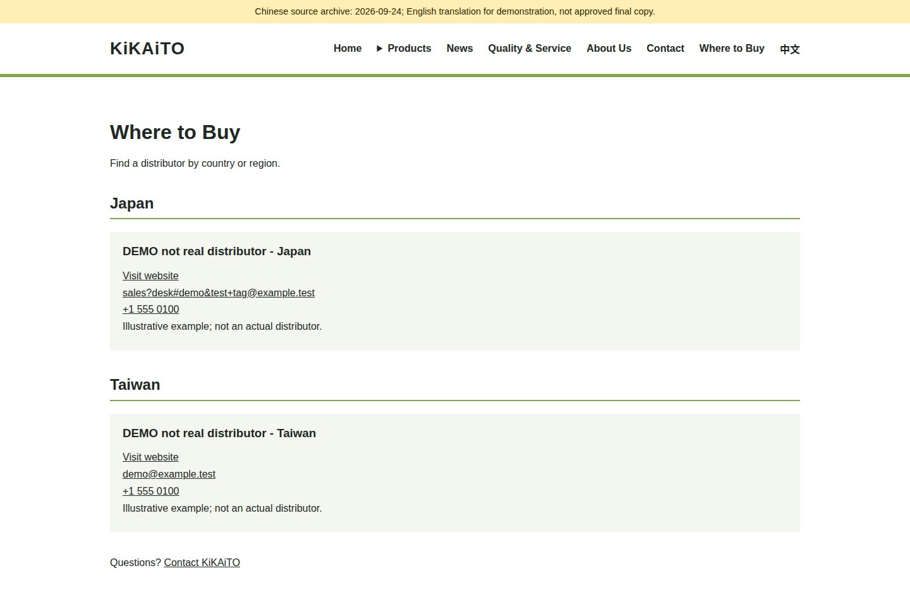

Caption: Illustrative address with punctuation | English preview 2026-11-02

- [Create a temporary illustrative distributor, publish it and open the directory; it was removed after recording](video/final-admin-distributor-create.mp4)
- [Change an illustrative distributor’s country and order, then unpublish and restore it](video/final-admin-distributor.mp4)
- [Save an illustrative email address containing punctuation and show the directory entry; no mail application is opened](video/final-admin-reserved-email.mp4)

## Chinese pages and existing links

Customer features: [#5](https://github.com/BTTSpace/KiKAiTO-client-communication/issues/5), [#16](https://github.com/BTTSpace/KiKAiTO-client-communication/issues/16).

The Chinese pages shown use the source archive. Their content, identifiers and image paths were checked after the Demo editing operations. The Chinese homepage can extend beyond the screen width on mobile.

Screen state: English preview 2026-11-02, showing published content or staff preview as described below.

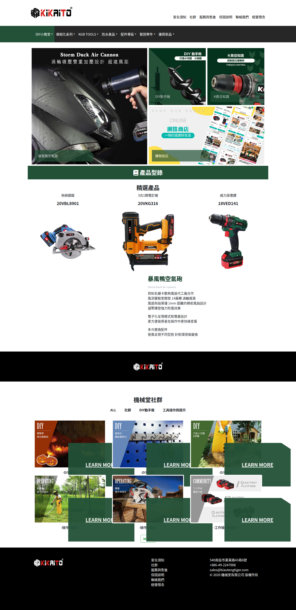

Caption: Chinese homepage, desktop | English preview 2026-11-02

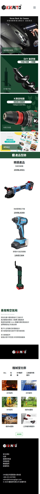

Caption: Chinese homepage, mobile | English preview 2026-11-02

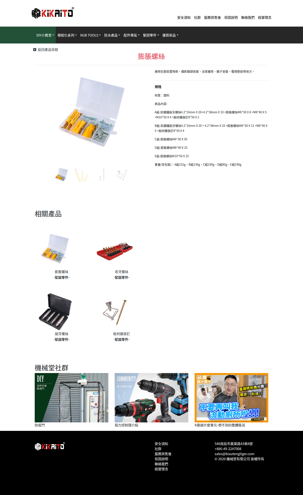

Caption: Chinese product, desktop | English preview 2026-11-02

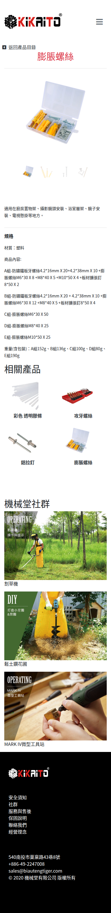

Caption: Chinese product, mobile | English preview 2026-11-02

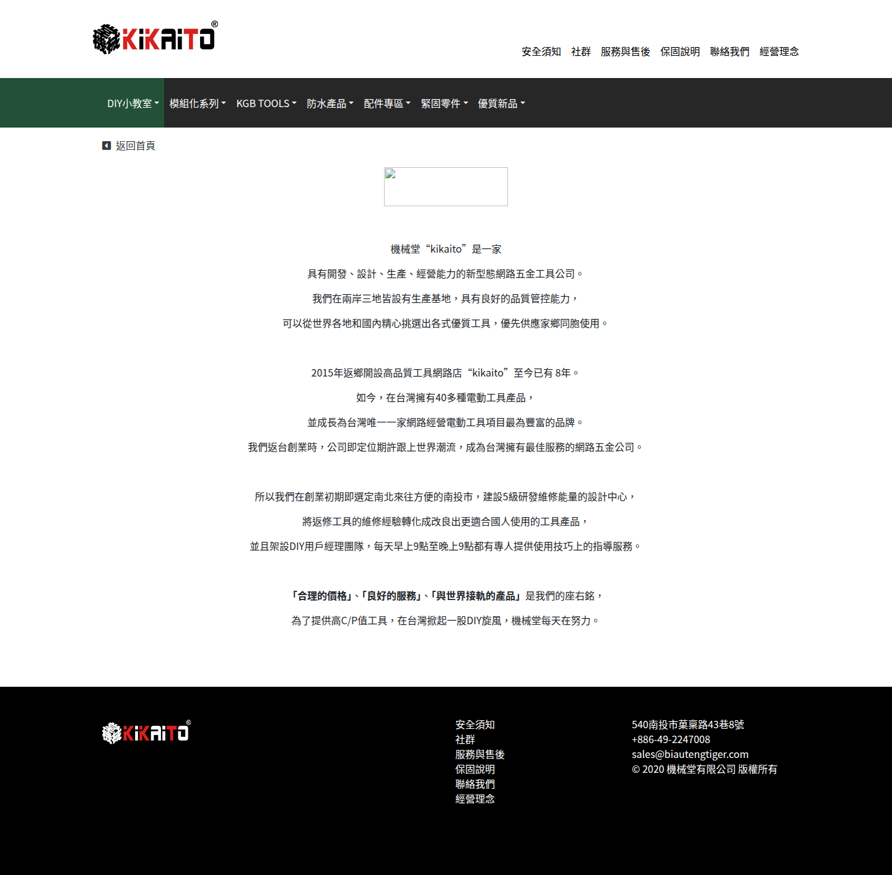

Caption: Chinese information, desktop | English preview 2026-11-02

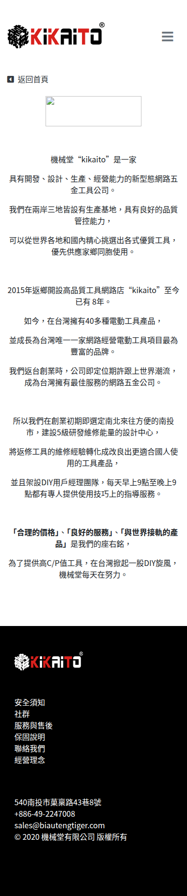

Caption: Chinese information, mobile | English preview 2026-11-02

- [Desktop Chinese homepage, product and information pages](video/final-chinese-desktop.mp4)
- [Mobile Chinese homepage, product and information pages](video/final-chinese-mobile.mp4)

中文說明（點此展開）

> 2026-11-03：此歷史展示使用較早的主題。請參閱[修正後的主題展示](../english-theme-preview-2026-11-03/README.md)；驗收仍待進行。

# 英文網站展示 2026-11-02

中文來源封存日期：**2026-09-24**。英文內容為示範翻譯，並非已核准正式文案；此封存無法確認目前正式網站的內容。原圖片可能含中文字，商品型號或 SKU 欄位也可能保留中文；規格、安全與行銷敘述尚未獨立驗證。封存的聯絡電話及地址是歷史來源值，尚未確認目前有效，請勿依此展示作實際聯絡。

展示包含 225 筆翻譯來源商品，重用 1,079 張來源商品圖片；103 張不同的封存內嵌插圖未納入。標示 DEMO 的影片、News 與經銷商為另外加入的功能示例，示例經銷商並非真實合作商。客戶核對與驗收仍待進行；實際郵件應用撰寫畫面、遠端 YouTube 播放及外部電話／郵件應用啟動尚未驗證，沒有寄出郵件。

[展示與回饋](https://github.com/BTTSpace/KiKAiTO-client-communication/issues/15)。

## 首頁與導覽

客戶功能：[#6](https://github.com/BTTSpace/KiKAiTO-client-communication/issues/6)、[#13](https://github.com/BTTSpace/KiKAiTO-client-communication/issues/13)、[#16](https://github.com/BTTSpace/KiKAiTO-client-communication/issues/16)、[#18](https://github.com/BTTSpace/KiKAiTO-client-communication/issues/18)。

桌機及手機畫面顯示英文首頁與導覽。精選商品為翻譯封存內容中的示範選擇，不代表歷史上的精選商品。

畫面狀態：English preview 2026-11-02，依以下圖說顯示已發布內容或管理者預覽。

圖說：桌機首頁 | English preview 2026-11-02

圖說：手機首頁 | English preview 2026-11-02

- [桌機：首頁、分類、商品、News、資訊頁、經銷商名單及返回中文](video/final-visitor-desktop.mp4)
- [手機：相同訪客瀏覽流程](video/final-visitor-mobile.mp4)

## 影片封面與動態

客戶功能：[#6](https://github.com/BTTSpace/KiKAiTO-client-communication/issues/6)、[#13](https://github.com/BTTSpace/KiKAiTO-client-communication/issues/13)、[#18](https://github.com/BTTSpace/KiKAiTO-client-communication/issues/18)。

三個封面是功能示例影片，並非封存的公司影片。錄影展示逐一播放及以鍵盤暫停，並分別模擬裝置減少動態設定開啟與關閉；無法播放狀態為模擬。

畫面狀態：English preview 2026-11-02，依以下圖說顯示已發布內容或管理者預覽。

圖說：桌機，一般動態 | English preview 2026-11-02

圖說：桌機，減少動態 | English preview 2026-11-02

圖說：手機，一般動態 | English preview 2026-11-02

圖說：手機，減少動態 | English preview 2026-11-02

圖說：模擬播放失敗 | English preview 2026-11-02

圖說：示例影片標題編輯欄 | English preview 2026-11-02

- [桌機一般動態：播放並暫停三段示例影片](video/final-video-desktop-no-preference.mp4)
- [桌機減少動態：播放與暫停](video/final-video-desktop-reduce.mp4)
- [手機一般動態：播放與暫停](video/final-video-mobile-no-preference.mp4)
- [手機減少動態：播放與暫停](video/final-video-mobile-reduce.mp4)
- [模擬影片無法播放](video/final-video-failure.mp4)
- [管理者儲存示例影片草稿，比較預覽與公開頁，再發布及取消發布](video/final-admin-video.mp4)

## 商品與分類

客戶功能：[#4](https://github.com/BTTSpace/KiKAiTO-client-communication/issues/4)、[#7](https://github.com/BTTSpace/KiKAiTO-client-communication/issues/7)、[#11](https://github.com/BTTSpace/KiKAiTO-client-communication/issues/11)、[#12](https://github.com/BTTSpace/KiKAiTO-client-communication/issues/12)。

分類及商品使用翻譯封存內容。後台錄影展示清楚標示為非封存的暫時示例商品與分類，以及封存商品的草稿、預覽、發布、圖片修改及取消發布；暫時示例商品和分類錄後已刪除。其中一個分類畫面另有商品的封存名稱與描述不一致，其規格仍須核對。

畫面狀態：English preview 2026-11-02，依以下圖說顯示已發布內容或管理者預覽。

圖說：桌機分類 | English preview 2026-11-02

圖說：手機分類 | English preview 2026-11-02

圖說：桌機商品 | English preview 2026-11-02

圖說：手機商品 | English preview 2026-11-02

圖說：商品英文草稿欄 | English preview 2026-11-02

圖說：英文分類編輯欄 | English preview 2026-11-02

- [新增暫時示例主分類、子分類及一筆雙語商品，預覽並發布至兩個分類](video/final-admin-create.mp4)
- [修改商品文字與分類：管理者預覽顯示草稿，公開頁在發布前維持已發布版本](video/final-admin-category-draft.mp4)
- [上傳暫時示例圖片：預覽、比較公開版本、發布並恢復原圖片](video/final-admin-image.mp4)
- [取消發布商品，首頁與分類不再顯示，再重新發布](video/final-admin-product-unpublish.mp4)

## 精選商品與分類圖示

客戶功能：[#6](https://github.com/BTTSpace/KiKAiTO-client-communication/issues/6)、[#12](https://github.com/BTTSpace/KiKAiTO-client-communication/issues/12)、[#13](https://github.com/BTTSpace/KiKAiTO-client-communication/issues/13)。

首頁使用兩筆封存商品作為示範精選，並顯示翻譯分類圖示。錄影展示順序與圖示修改的預覽和發布，以及取消與恢復精選。

畫面狀態：English preview 2026-11-02，依以下圖說顯示已發布內容或管理者預覽。

圖說：精選選擇欄 | English preview 2026-11-02

圖說：分類圖示標題欄 | English preview 2026-11-02

- [修改兩筆精選商品順序：預覽、原公開順序、發布與恢復](video/final-admin-featured-order.mp4)
- [取消精選但保留商品頁](video/final-admin-featured-toggle.mp4)
- [編輯分類圖示：草稿預覽、公開舊版、發布及取消發布](video/final-admin-icon.mp4)

## News

客戶功能：[#8](https://github.com/BTTSpace/KiKAiTO-client-communication/issues/8)、[#13](https://github.com/BTTSpace/KiKAiTO-client-communication/issues/13)、[#18](https://github.com/BTTSpace/KiKAiTO-client-communication/issues/18)。

消息明確標示為功能示例，並非封存消息或公司活動。

畫面狀態：English preview 2026-11-02，依以下圖說顯示已發布內容或管理者預覽。

圖說：桌機示例消息 | English preview 2026-11-02

圖說：手機示例消息 | English preview 2026-11-02

圖說：示例 News 標題欄 | English preview 2026-11-02

- [編輯示例消息，比較管理者預覽與公開文章，再發布及取消發布](video/final-admin-news.mp4)

## 資訊頁

客戶功能：[#9](https://github.com/BTTSpace/KiKAiTO-client-communication/issues/9)、[#14](https://github.com/BTTSpace/KiKAiTO-client-communication/issues/14)。

Quality & Service、About Us 和 Contact 使用翻譯封存內容。錄影使用清楚標示的暫時示範修改，之後恢復原英文內容。

畫面狀態：English preview 2026-11-02，依以下圖說顯示已發布內容或管理者預覽。

圖說：桌機 Quality & Service | English preview 2026-11-02

圖說：手機 Quality & Service | English preview 2026-11-02

圖說：桌機 About Us | English preview 2026-11-02

圖說：手機 About Us | English preview 2026-11-02

圖說：桌機 Contact | English preview 2026-11-02

圖說：手機 Contact | English preview 2026-11-02

圖說：資訊頁內容編輯欄 | English preview 2026-11-02

- [在雙語同頁編輯英文、預覽並發布，再核對中文頁未改變](video/final-admin-bilingual-info.mp4)
- [暫時修改、預覽並發布 Quality & Service 文字，再恢復](video/final-admin-quality-service.mp4)
- [暫時修改、預覽並發布 Contact 文字，再恢復](video/final-admin-contact.mp4)
- [取消發布並重新發布英文資訊頁](video/final-admin-information-unpublish.mp4)

## 電子郵件詢價

客戶功能：[#7](https://github.com/BTTSpace/KiKAiTO-client-communication/issues/7)、[#10](https://github.com/BTTSpace/KiKAiTO-client-communication/issues/10)。

商品頁提供電子郵件詢價連結。管理者修改示範收件地址後，已核對連結使用新地址；尚未展示實際郵件應用，沒有寄出郵件。

畫面狀態：English preview 2026-11-02，依以下圖說顯示已發布內容或管理者預覽。

圖說：桌機商品詢價入口 | English preview 2026-11-02

圖說：手機商品詢價入口 | English preview 2026-11-02

圖說：示範收件地址設定 | English preview 2026-11-02

- [修改示範收件地址並返回商品詢價入口](video/final-admin-recipient.mp4)

## Where to Buy

客戶功能：[#17](https://github.com/BTTSpace/KiKAiTO-client-communication/issues/17)、[#18](https://github.com/BTTSpace/KiKAiTO-client-communication/issues/18)。

所有列出的經銷商均為明確標示非真實的功能示例；其地址及聯絡資料均為示例。

畫面狀態：English preview 2026-11-02，依以下圖說顯示已發布內容或管理者預覽。

圖說：桌機示例經銷商名單 | English preview 2026-11-02

圖說：手機示例經銷商名單 | English preview 2026-11-02

圖說：示例經銷商編輯欄 | English preview 2026-11-02

圖說：含標點的示例電子郵件 | English preview 2026-11-02

- [新增並發布暫時示例經銷商，開啟名單；錄後已刪除](video/final-admin-distributor-create.mp4)
- [修改示例經銷商國家及順序，再取消發布及恢復](video/final-admin-distributor.mp4)
- [儲存含標點的示例電子郵件地址並顯示名單項目；未開啟郵件應用](video/final-admin-reserved-email.mp4)

## 中文頁與既有連結

客戶功能：[#5](https://github.com/BTTSpace/KiKAiTO-client-communication/issues/5)、[#16](https://github.com/BTTSpace/KiKAiTO-client-communication/issues/16)。

所示中文頁使用來源封存資料；示範編輯後已核對其內容、識別資料及圖片路徑。中文首頁在手機上可能超出螢幕寬度。

畫面狀態：English preview 2026-11-02，依以下圖說顯示已發布內容或管理者預覽。

圖說：桌機中文首頁 | English preview 2026-11-02

圖說：手機中文首頁 | English preview 2026-11-02

圖說：桌機中文商品 | English preview 2026-11-02

圖說：手機中文商品 | English preview 2026-11-02

圖說：桌機中文資訊頁 | English preview 2026-11-02

圖說：手機中文資訊頁 | English preview 2026-11-02

- [桌機中文首頁、商品及資訊頁](video/final-chinese-desktop.mp4)
- [手機中文首頁、商品及資訊頁](video/final-chinese-mobile.mp4)

