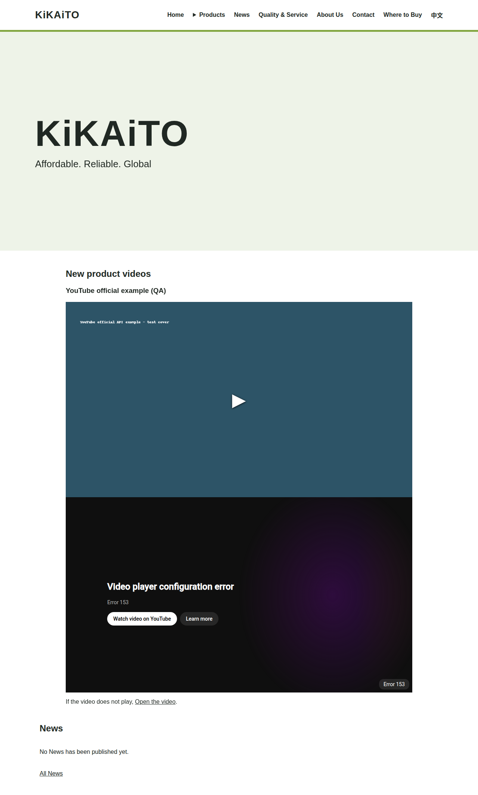
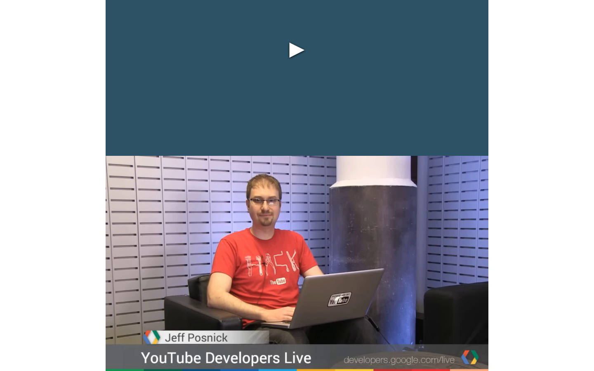
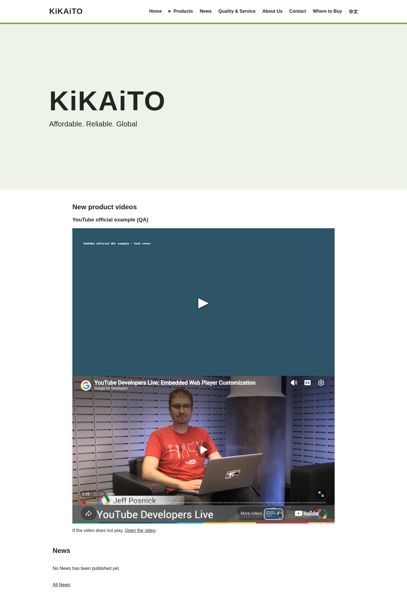
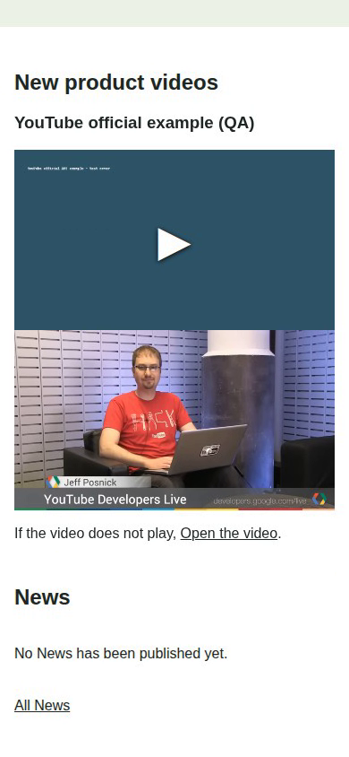
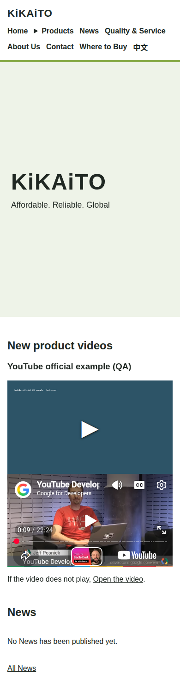

# YouTube playback: supplementary check

**English preview, YouTube playback check, 2026-11-02.** In the earlier preview, selecting the YouTube example produced player error 153. In a separate corrected preview, the same example played and paused on desktop and mobile layouts. This check used Google Chrome 156.0.8078.79 on 2 November 2026. The mobile layout was tested in a browser-sized mobile viewport, not on a physical phone.

The video is the [official YouTube Developers example](https://www.youtube.com/watch?v=M7lc1UVf-VE) used in the [YouTube player documentation](https://developers.google.com/youtube/iframe_api_reference). It is a demonstration of playback, not a KiKAiTO product video. These recordings show the separate corrected playback-test preview; the [full archive demonstration](https://github.com/BTTSpace/KiKAiTO-client-communication/blob/main/docs/demos/english-preview-2026-11-02/README.md) is documented separately.

**Customer features [#6](https://github.com/BTTSpace/KiKAiTO-client-communication/issues/6), [#13](https://github.com/BTTSpace/KiKAiTO-client-communication/issues/13), and [#18](https://github.com/BTTSpace/KiKAiTO-client-communication/issues/18): earlier error, English preview, 2026-11-02.** Select the video cover on the English home page; the earlier player shows error 153.

**Customer features #6, #13, and #18: corrected preview, desktop playback and pause, 2026-11-02.** The official example plays after selection and pauses when the player is selected again.

[Watch the desktop playback and pause recording](desktop-play-pause.mp4)

**Customer features #6, #13, and #18: corrected preview, mobile-sized playback and pause, 2026-11-02.** The same example plays and pauses in a mobile-sized browser viewport.

[Watch the mobile-sized playback and pause recording](mobile-play-pause.mp4)

The external email application compose window and external telephone and email handler launches remain unverified. Customer review and acceptance remain pending.

中文

**英文展示版，YouTube 播放補充驗證，2026-11-02。** 先前的展示版選取 YouTube 範例後出現播放器錯誤 153。在獨立的修正展示版中，同一範例已於桌機及手機尺寸版面播放與暫停。本次於 2026 年 11 月 2 日使用 Google Chrome 156.0.8078.79 測試；手機版面是在瀏覽器的手機尺寸視窗測試，並非實體手機。

影片是 [YouTube Developers 官方範例](https://www.youtube.com/watch?v=M7lc1UVf-VE)，亦用於 [YouTube 播放器文件](https://developers.google.com/youtube/iframe_api_reference)。影片僅用於播放功能展示，並非 KiKAiTO 商品影片。這些錄影呈現獨立的播放修正測試展示版；[完整封存資料展示](https://github.com/BTTSpace/KiKAiTO-client-communication/blob/main/docs/demos/english-preview-2026-11-02/README.md)另有說明。

**客戶功能 [#6](https://github.com/BTTSpace/KiKAiTO-client-communication/issues/6)、[#13](https://github.com/BTTSpace/KiKAiTO-client-communication/issues/13)、[#18](https://github.com/BTTSpace/KiKAiTO-client-communication/issues/18)：先前錯誤，英文展示版，2026-11-02。** 在英文首頁選取影片封面後，先前的播放器顯示錯誤 153。

**客戶功能 #6、#13、#18：修正展示版，桌機播放與暫停，2026-11-02。** 選取後官方範例開始播放，再選取播放器即可暫停。

[觀看桌機播放與暫停錄影](desktop-play-pause.mp4)

**客戶功能 #6、#13、#18：修正展示版，手機尺寸播放與暫停，2026-11-02。** 相同範例可在手機尺寸瀏覽器視窗播放與暫停。

[觀看手機尺寸播放與暫停錄影](mobile-play-pause.mp4)

外部郵件應用程式撰寫視窗，以及外部電話與電子郵件處理程式的啟動，仍未驗證。客戶檢視及驗收仍待進行。

