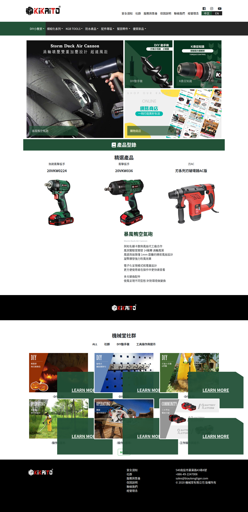
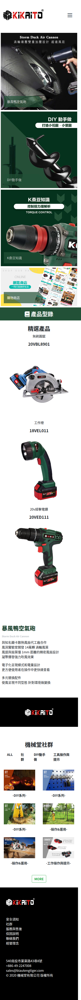
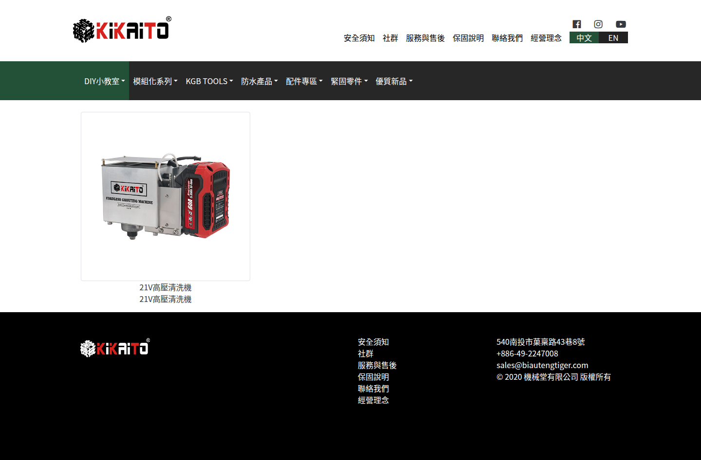
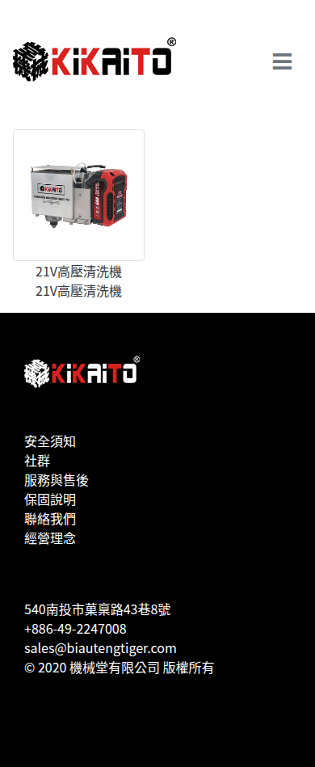
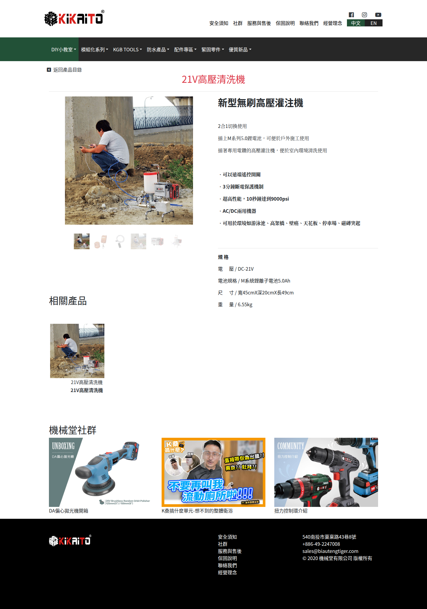
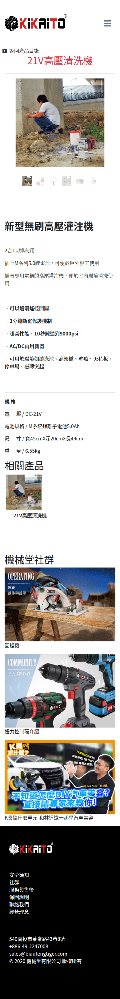
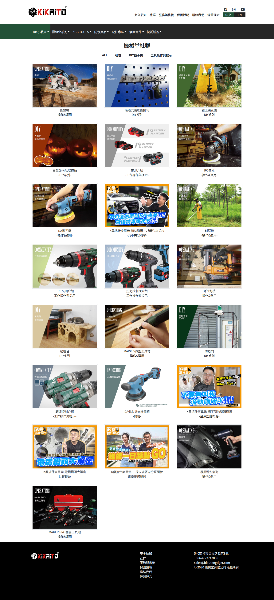
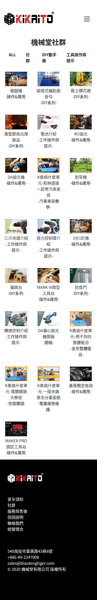
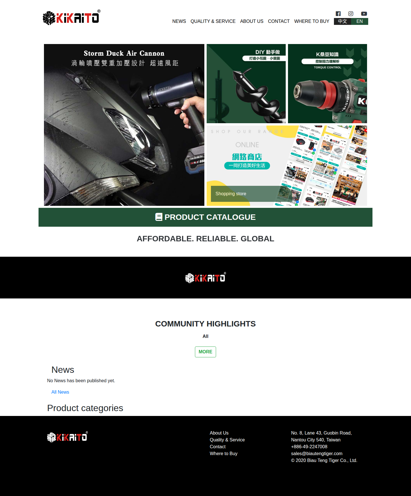
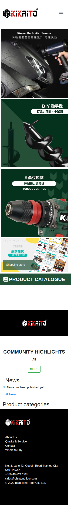

> Historical demonstration. See the [current English content demonstration](../english-content-2026-11-04/README.md).

# Website content demonstration, 2026-11-04

These screenshots show the hosted development site with the designated source content snapshot from 2026-11-04. They cover the pages pictured below, not a visual review of every product or the current public website.

The source already had 103 embedded media references without files, so some content may be missing. No new English translation was added, and English content was not supplied for this snapshot. Earlier English demonstrations are historical and do not represent the current demonstration content.

The project owner can provide the interactive development demonstration. The [language switch recording](media/language-switch.webm) can be downloaded; it shows a visitor switching from Chinese to English and back to Chinese. Customer acceptance has not been recorded.

## Screenshots

### Home

Open the Chinese homepage to see its content.

Caption: Home, desktop | development demonstration, 2026-11-04

Caption: Home, mobile | development demonstration, 2026-11-04

### Category

Open the waterproof products category to see its listing.

Caption: Category, desktop | development demonstration, 2026-11-04

Caption: Category, mobile | development demonstration, 2026-11-04

### Product

Open the cordless grouting machine product to see its details.

Caption: Product, desktop | development demonstration, 2026-11-04

Caption: Product, mobile | development demonstration, 2026-11-04

### Community

Open Community to see its listing.

Caption: Community, desktop | development demonstration, 2026-11-04

Caption: Community, mobile | development demonstration, 2026-11-04

### English entry

Choose the English entry to see the English page.

Caption: English entry, desktop | development demonstration, 2026-11-04

Caption: English entry, mobile | development demonstration, 2026-11-04

中文說明（點此展開）

# 網站內容展示，2026-11-04

以上截圖呈現託管開發網站使用 2026-11-04 指定來源內容快照的畫面。範圍限於圖中頁面，並非所有商品的視覺檢查，也不代表目前公開網站內容。

來源既有 103 個內嵌媒體引用沒有對應檔案，因此部分內容可能缺失。此次沒有新增英文翻譯，此快照也未提供英文內容。先前的英文展示屬歷史資料，不代表目前展示內容。

負責人可提供互動開發展示。[語言切換錄影](media/language-switch.webm)可下載，呈現訪客由中文切換至英文，再返回中文。尚未記錄客戶驗收。

## 畫面說明

以下圖說對應上方共用截圖，展示版本皆為 2026-11-04 的開發展示。

### 首頁

開啟中文首頁，查看首頁內容。

- 圖說：首頁，桌機 | 開發展示，2026-11-04
- 圖說：首頁，手機 | 開發展示，2026-11-04

### 分類

開啟防水產品分類，查看分類列表。

- 圖說：分類，桌機 | 開發展示，2026-11-04
- 圖說：分類，手機 | 開發展示，2026-11-04

### 商品

開啟無線灌注機商品，查看商品內容。

- 圖說：商品，桌機 | 開發展示，2026-11-04
- 圖說：商品，手機 | 開發展示，2026-11-04

### 社群

開啟 Community，查看文章列表。

- 圖說：社群，桌機 | 開發展示，2026-11-04
- 圖說：社群，手機 | 開發展示，2026-11-04

### 英文入口

選擇英文入口，查看英文頁面。

- 圖說：英文入口，桌機 | 開發展示，2026-11-04
- 圖說：英文入口，手機 | 開發展示，2026-11-04

