Use this guide to find the English editing and publication controls while preserving Chinese content. Open the [development website](https://kikaito.hjhouse.online/) to review results.

**Draft procedure, read-only screenshots:** the actual administration screens were inspected, but Save, Publish, Unpublish and final Delete were not executed for this guide. The instructions below describe the controls and implementation; they are not evidence of a completed editing or publication test. Screenshots show desktop only. Use an administrator account supplied privately; do not post passwords here.

繁體中文

本指南說明英文內容編輯與發布入口，以及保留中文內容的注意事項。可至[開發網站](https://kikaito.hjhouse.online/)核對結果。

**操作步驟草稿，圖片為唯讀檢視：**已檢查實際後台畫面，但未為本指南執行儲存、發布、下架或最終刪除。下列步驟依畫面與實作整理，不代表已完成編輯發布驗收；圖片僅涵蓋桌機。請使用私下提供的管理帳號，不要在此留言帳密。

## English and Chinese relationship / 中英文對應關係

| English module | Chinese relationship | 中文對應關係 |
| --- | --- | --- |
| Products | Same product record; English text, categories and images have their own fields. Deleting the product affects both languages. | 同一筆商品；英文文字、分類、圖片各有欄位。刪除商品會影響中英文。 |
| English main/subcategories | Independent category structure, assigned separately. | 英文分類獨立建立及指定，不會自動套用中文分類。 |
| English homepage videos / category icons | English-only records, separate from Chinese homepage content. | 與中文首頁影片及圖示分開管理。 |
| English News | Separate English articles; no automatic translation or synchronization. | 獨立英文文章，不會自動翻譯或同步中文消息。 |
| Information pages | Explicit Corresponding Chinese page link; English content is edited separately. | 透過 Corresponding Chinese page 配對，內文各自編輯。 |
| Distributors | Separate English Where to Buy directory. | 獨立的英文 Where to Buy 經銷商名單。 |

## 1. Sign in / 登入

Open [the administration area](https://kikaito.hjhouse.online/admin/) with an account authorized to edit website content. A feedback-only account cannot manage these modules. The screen may show Chinese navigation and English content labels.

繁體中文

使用具有網站內容編輯權限的帳號登入[後台](https://kikaito.hjhouse.online/admin/)。只有回饋權限的帳號不能管理這些模組。畫面可能同時顯示中文導覽與英文內容欄位。

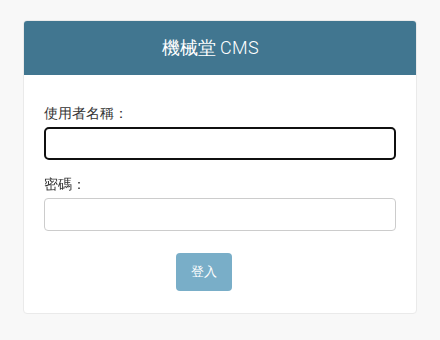

## 2. Choose a content module / 選擇內容模組

Use Products under the product section for bilingual products. Under the page section, choose Information pages, English News, English homepage videos, English homepage category icons, or Distributors. Use the table below to identify the corresponding Chinese content.

繁體中文

雙語商品請進入「產品相關」的「產品」。頁面相關區提供 Information pages、English News、English homepage videos、English homepage category icons、Distributors。中英內容的關係請見下方對照表。

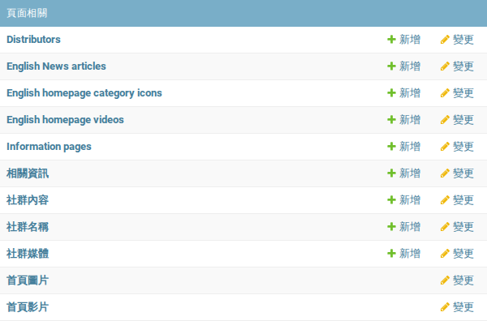

## 3. Open the existing product / 開啟既有商品

For an English version of an existing Chinese product, open that same product. Its Chinese and shared fields are in the upper part of the form. Changing and saving those fields can change the Chinese product. For a completely new product, complete the required Chinese/shared fields and save it before publishing English.

繁體中文

替既有中文商品補英文時，請開啟同一筆商品。表單上方是中文及共用欄位，修改後儲存可能改到中文商品。全新商品需先填妥必要的中文／共用欄位並儲存，再發布英文。

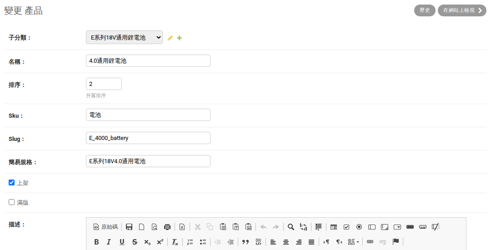

## 4. Edit the English draft / 編輯英文草稿

Fill English name, English description and English specifications. Select the relevant English subcategories; more than one may be selected. English categories are managed separately from Chinese categories. Use Save (儲存) to keep the English draft; the published English snapshot remains until you publish again.

繁體中文

填寫 English name、English description、English specifications，並選擇適用的 English subcategories，可複選。英文分類獨立管理，不會自動跟隨中文分類。按「儲存」保存英文草稿；重新發布前，英文前台保留上次已發布版本。

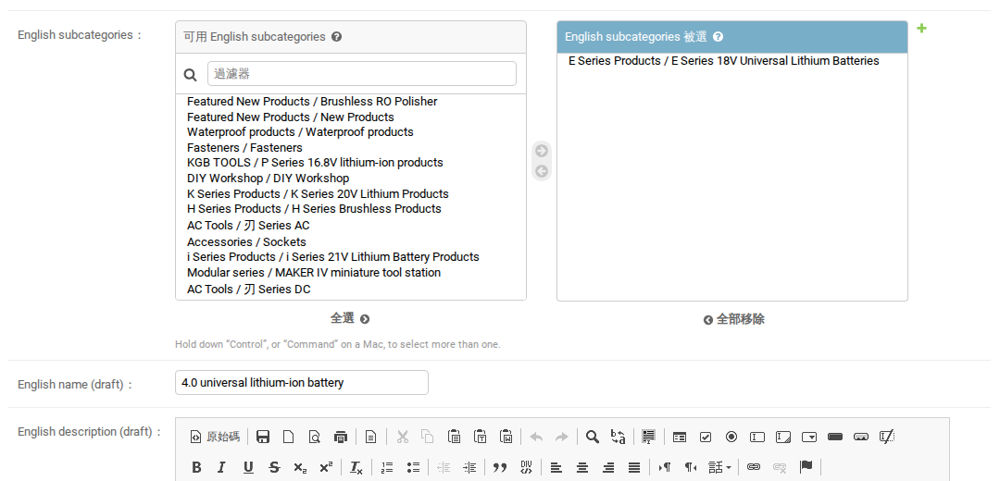

## 5. Manage English product images / 管理英文商品圖片

Use English product images for English-specific uploads and ordering. This image shows an empty new-product form to identify the fields. These uploads are separate from Chinese product images. Save the draft and publish English to apply image edits or removals to the English page.

繁體中文

在 English product images 上傳及排序英文專用圖片。此圖為新增商品的空白欄位示意，圖片與中文商品圖片分開。修改或移除英文圖片後，需儲存並發布英文，才會套用到英文頁面。

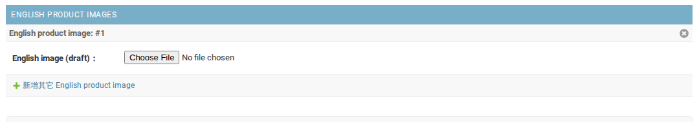

## 6. Preview and feature a product / 預覽與設定英文首頁商品

After saving, use Preview saved English draft or Preview homepage to review the saved draft. To feature a product on the English homepage, enable Feature on English homepage and provide its English homepage image and order. Review the actual image and text before publishing.

繁體中文

儲存後，使用 Preview saved English draft 或 Preview homepage 檢查已保存的草稿。要放入英文首頁，勾選 Feature on English homepage，並提供英文首頁圖片及排序。發布前請檢查實際圖片與文字。

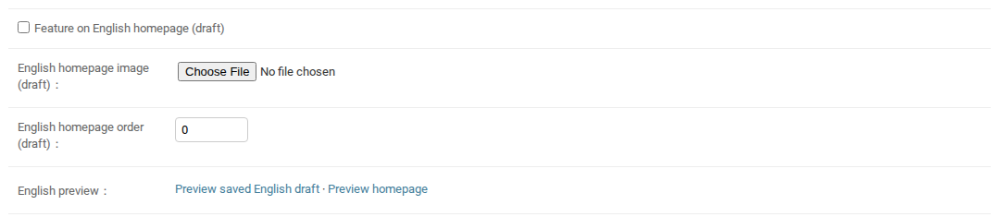

## 7. Publish or hide English / 發布或下架英文

On an existing product, Save and publish English saves and publishes the English draft. English name is required; a featured product also needs its English homepage image. Save and unpublish English hides the English product. Leave the Chinese/shared fields unchanged when you only intend to change English. Ordinary Save is not English publication.

繁體中文

在既有商品頁，Save and publish English 會儲存並發布英文草稿。英文名稱必填；勾選首頁展示時也需英文首頁圖片。Save and unpublish English 會下架英文商品。只要改英文時，請保持中文及共用欄位不變。一般「儲存」不等於發布英文。

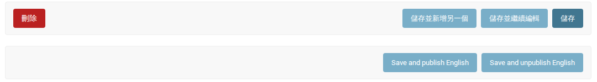

## 8. Product deletion affects both languages / 刪除商品會影響中英文

Warning: Delete removes the whole product, including its Chinese content and related image records. The confirmation page lists the affected records. To hide only English, cancel deletion and use Save and unpublish English instead. There is no undo button for permanent deletion; ask the site maintainer about recovery before confirming. This screenshot only views the confirmation page; nothing was deleted.

繁體中文

警告：「刪除」會移除整筆商品，包括中文內容及相關圖片紀錄。確認頁會列出受影響項目。只想下架英文時，請取消刪除，改用 Save and unpublish English。永久刪除沒有復原按鈕，確認前應先向維護者確認回復方式。此圖僅檢視確認頁，未刪除任何資料。

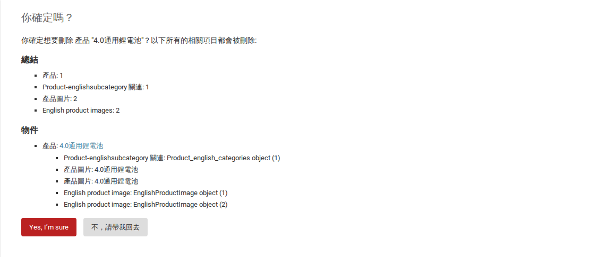

## 9. English categories / 英文分類

Create an English main category first, then add an English subcategory and choose its Parent. Enter its name, slug and order. Published plus Save controls category availability; it does not use the product publish buttons. Assign products to the English subcategories separately. Before deleting a category, check dependent subcategories and homepage icons; protected references may prevent deletion.

繁體中文

先建立 English main category，再新增 English subcategory 並選擇 Parent。填寫名稱、slug 與排序，以 Published 勾選狀態配合「儲存」控制分類是否發布，不使用商品的發布按鈕。商品需另行指定英文子分類。刪除分類前先檢查子分類及首頁圖示等關聯；受保護的引用可能阻擋刪除。

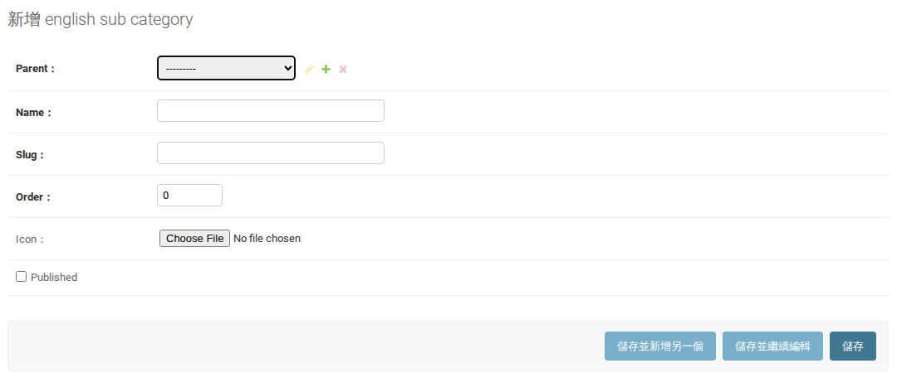

## 10. English News / 英文消息

Add or open an English News article. Edit Title, Summary, Content, Date, Image and Order, then save the draft. From the list, select the saved article and use Publish selected articles or Unpublish selected articles, then the Go (去) button. Delete permanently removes that English article. Publication actions for this module were checked in the implementation; the empty list did not display them during this screenshot session.

繁體中文

新增或開啟 English News，編輯 Title、Summary、Content、Date、Image、Order 後儲存草稿。回列表勾選已保存文章，選 Publish selected articles 或 Unpublish selected articles，再按「去」。刪除會永久移除該英文文章。本模組發布動作已核對實作，但拍攝當時列表為空，未拍到動作選單。

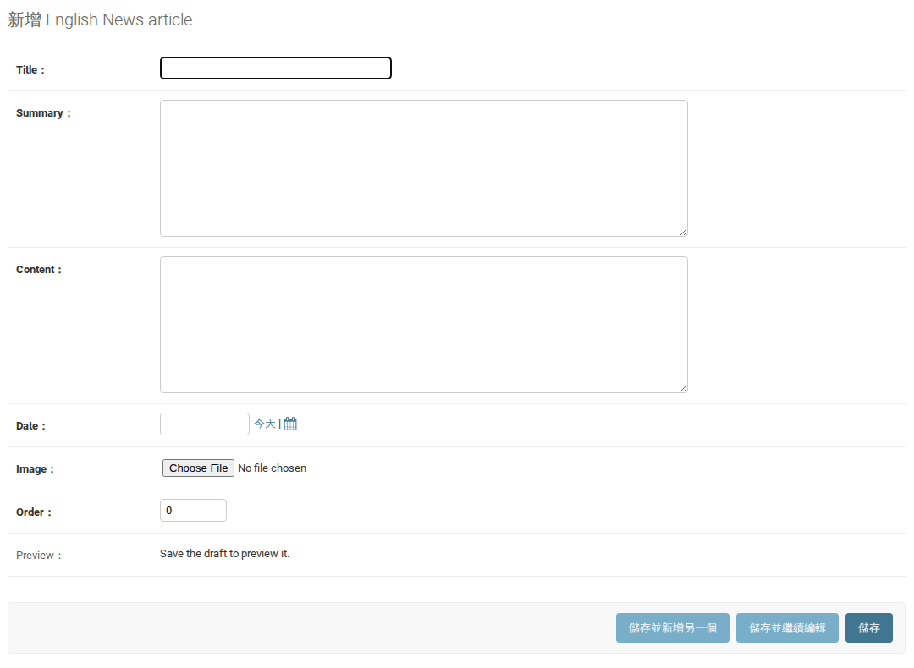

## 11. English homepage videos / 英文首頁影片

Edit Title, Video URL, Introduction, Cover and Order. Save the draft and review Preview all video drafts. English homepage videos are separate from the Chinese homepage video records. Saving a draft retains the previous published English version.

繁體中文

編輯 Title、Video URL、Introduction、Cover、Order，儲存後使用 Preview all video drafts 檢查。英文首頁影片與中文首頁影片是不同紀錄，儲存草稿會保留原先已發布的英文版本。

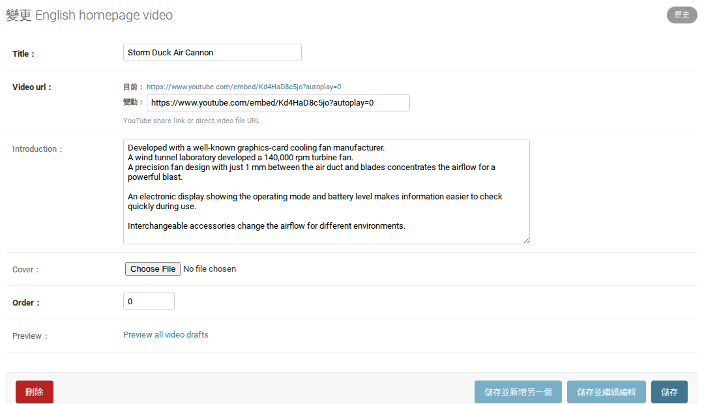

## 12. List publication actions / 列表發布動作

In the video list, select the target row, choose Publish selected videos or Unpublish selected videos, then use Go (去). Check the selected rows before executing. This image shows selection only; Go was not pressed. To restore a hidden item, publish it again. Permanent Delete is different from unpublishing.

繁體中文

在影片列表勾選目標，選 Publish selected videos 或 Unpublish selected videos，再按「去」。執行前確認勾選項目。此圖只有選取動作，未按「去」。下架項目可重新發布；永久刪除與下架不同。

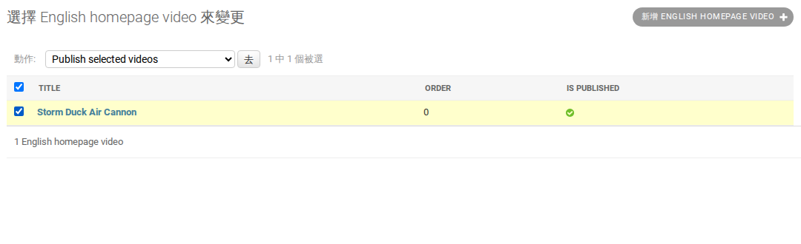

## 13. English homepage category icons / 英文首頁分類圖示

Edit Title, Category, Image and Order. Category points to an English subcategory. Save the draft, then use Publish selected category icons or Unpublish selected category icons from the list. Delete removes the English icon entry, not its Chinese counterpart. The publication menu was checked in the implementation but not captured because this list was empty.

繁體中文

編輯 Title、Category、Image、Order；Category 指向英文子分類。儲存草稿後，在列表使用 Publish selected category icons 或 Unpublish selected category icons。刪除只移除該英文圖示紀錄，不會刪除中文對應圖示。發布選單已核對實作，但因列表為空未拍到。

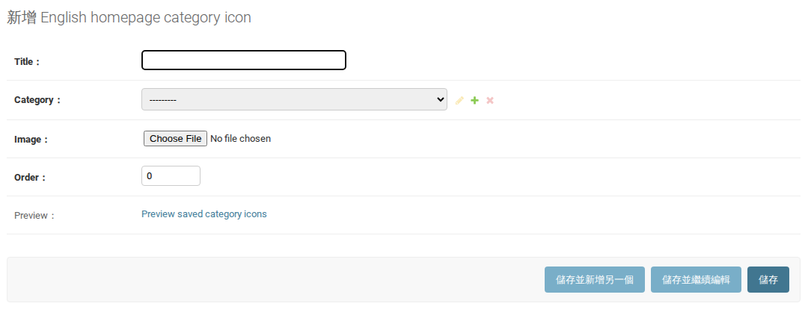

## 14. Information pages and Chinese pairing / 資訊頁與中文對應

Open the intended About Us, Quality / Service or Contact page. Keep its existing Slug to preserve its page address. Corresponding Chinese page identifies the related Chinese page; it does not translate or synchronize the content. Edit the English Title and Content separately. Preserve existing HTML formatting where present.

繁體中文

開啟要修改的 About Us、Quality / Service 或 Contact 頁面。保留原有 Slug，避免改動頁面網址。Corresponding Chinese page 用來指定相關中文頁，不會自動翻譯或同步內文。英文 Title 與 Content 需各自編輯，原有 HTML 格式請保留。

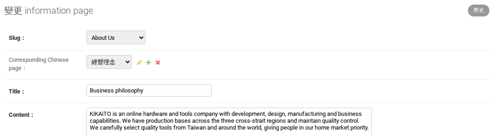

## 15. Publish information pages / 發布資訊頁

Save the English draft and open Preview saved draft before publication. In Information pages, select the intended pages and use Publish selected saved drafts or Unpublish selected English pages, then Go (去). Status indicates publication. This image shows the selected action only, without executing it. Prefer unpublishing over deleting a fixed information page; republishing can show it again.

繁體中文

先儲存英文草稿，使用 Preview saved draft 檢查。到 Information pages 勾選目標，選 Publish selected saved drafts 或 Unpublish selected English pages，再按「去」。Status 顯示發布狀態。此圖僅選取動作，未執行。固定資訊頁建議下架而非刪除，下架後可重新發布。

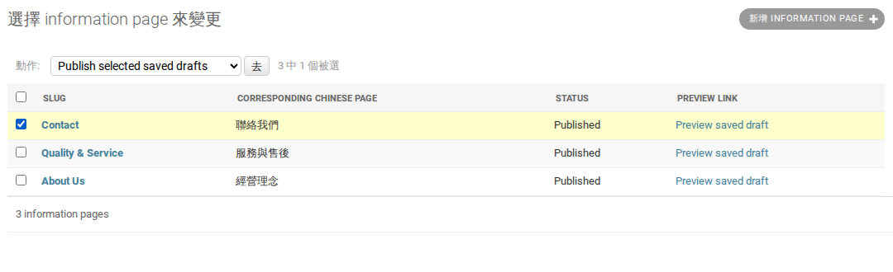

## 16. Where to Buy distributors / 經銷商名單

Add or open a Distributor. Enter Company, Country region, Website, Email, Phone, Contact details and Order. Enable Is published and save to display it, or clear it and save to hide it. Unlike the draft-publication modules, saving changes to an already published distributor updates the English directory immediately. Delete permanently removes the English distributor record. To prepare changes privately, unpublish it first.

繁體中文

新增或開啟 Distributor，填寫 Company、Country region、Website、Email、Phone、Contact details、Order。勾選 Is published 並儲存會顯示，取消勾選並儲存會下架。此模組與草稿發布模式不同：已發布經銷商按「儲存」會立即更新英文名單。刪除會永久移除該英文經銷商。若需先私下整理，請先下架。

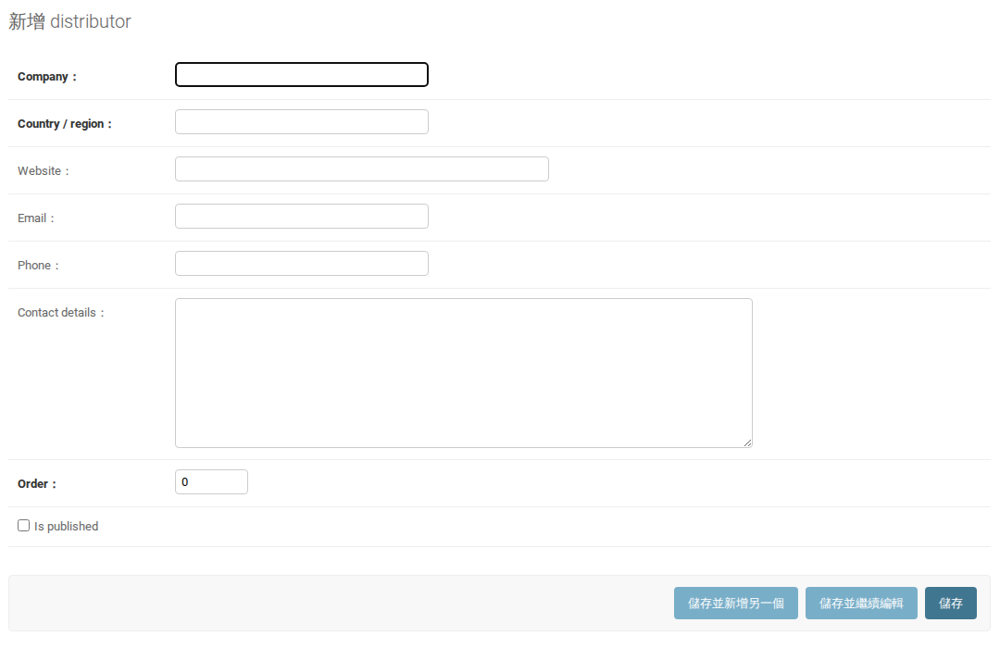

## Check the result / 核對結果

After you perform an edit, open the relevant English page while signed out and check its text, images, order and visibility. Check the matching Chinese page as well. Re-publish a saved draft to apply later changes. Re-publish an unpublished item to restore visibility. Permanent deletion has no ordinary undo control; contact the maintainer before confirming it. If expected controls are missing, check that you are in the correct module and have edit permission.

繁體中文

實際修改後，請在未登入狀態開啟英文頁面，核對文字、圖片、排序及是否顯示，也要核對對應中文頁。後續草稿修改需重新發布；下架項目可重新發布以恢復顯示。永久刪除沒有一般復原功能，確認前請聯絡維護者。若看不到預期控制，先確認模組及帳號編輯權限。

